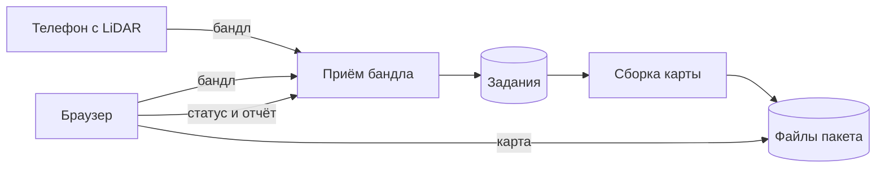

# 02. Стейкхолдеры, границы, альтернативы

## 2.1 Стейкхолдеры

Стейкхолдер — тот, на кого продукт влияет или кто влияет на него. Пользователи — одна из этих групп.

| Кто | Почему его касается продукт | Интерес | Влияние |
|-----|-----------------------------|---------|---------|
| Пользователи | Хотят игровой уровень с реального участка: короткой съёмки пола, стола или макета. Часто это один человек | Высокий: без карты уровень не из чего собрать | Высокое: их боль задаёт, что продукт умеет |
| Тот, кто ведёт сервис | Держит сервер, выпускает тестовую ссылку на четыре проверочных задания и видит загрузку, которая оборвалась | Высокий: иначе к картам не попасть | Высокое: без него ссылка и очередь не работают |
| Игрок на готовой карте | Продукт не открывает. Ходит по уровню, который собрали из съёмки | Высокий: провал сквозь пол ломает игру | Низкое: кнопки не выбирает |
| Владелец места | Снимают его пол, стол или макет. Может разрешить или запретить съёмку | Высокий: это его место | Низкое: функции продукта не выбирает |
| Человек в кадре | Может случайно попасть на видео, которое потом открывают другие | Высокий: не хочет оказаться в материалах | Низкое: кнопку не нажимает. Лицо крупным планом останавливает выпуск записи |

Интерес — насколько человеку важен результат. Влияние — насколько он меняет требования.

```text
                    Интерес →
                 Низкий              Высокий
           ┌───────────────────┬────────────────────────┐
  Высокое  │                   │ Пользователи           │
  влияние  │                   │ Тот, кто ведёт сервис  │
           ├───────────────────┼────────────────────────┤
  Низкое   │                   │ Игрок на готовой карте │
           │                   │ Владелец места         │
           │                   │ Человек в кадре        │
           └───────────────────┴────────────────────────┘
```

## 2.2 Границы релиза

### Входит

- Съёмка на iPhone или iPad с LiDAR: зона, обход, проверка записи, отправка бандла на сервер
- Сборка карты в размерах датчика и отчёт с метриками
- Отказ на непригодном входе вместо произвольной геометрии
- Приём бандла, очередь заданий, статус и выдача пакета
- Задания, метрики и ссылки на файлы хранятся; сами файлы пакета лежат отдельно
- Браузер: загрузка бандла, список своих заданий, отчёт, просмотр карты и ходьба по коллизии рядом с исходным кадром
- Открытое описание обмена: что принимается, что отдаётся, примеры успеха и отказа
- Сервис открывается по публичной ссылке. Пароли в собранную программу не входят. Среду можно поднять заново
- Проверочные записи: две пригодные и две непригодные. Тот, кто ведёт сервис, выпускает на них ссылку и может её заменить. Телефон для этого входа не нужен
- Загрузка, которая оборвалась, не остаётся без статуса: видно текущее задание, вторая сборка из-за обрыва не стартует

### Не входит

- Масштабирование карты под конкретный геймплей
- Полноценная игра и обязательная демонстрация в Unreal
- Обучение собственной модели глубины
- Android как платформа приёмки
- Панель пользователей, учётные записи, роли и просмотр чужих карт
- Сборка без глубины LiDAR. Она запускается только если этот способ включён в настройках и на приёмку релиза не влияет

### После релиза

Android в приёмке, текстуры, второй уровень детализации, собственная модель глубины.

## 2.3 Допущения

1. Для записи есть телефон с LiDAR.
2. Оператор и сборщик могут быть одним человеком.
3. Разработчик игры умеет открыть GLB.

## 2.4 Ограничения

1. Обязательная платформа съёмки — iOS и iPadOS на устройстве с LiDAR. Запись в симуляторе и в браузере не поддерживается.
2. Зона по умолчанию 80×80 см выбрана из-за объёма вычислений. Размер настраивается, пороги качества заданы для значения по умолчанию.
3. Обычный обход идёт с высоты около 0,5–0,8 м. Это способ съёмки, не причина отказа.
4. Пайплайн не меняет масштаб геометрии. Меш только центрируется, и это фиксируется в манифесте.
5. Формат карты задаёт glTF, съёмку — ARKit и LiDAR.

## 2.5 Альтернативы

| Вариант | Плюс | Минус для продукта |
|---------|------|--------------------|
| Ручная фотограмметрия с доводкой в редакторе | Привычный путь к мешу | Не повторяется одной командой и не даёт единого пакета из картинки и опоры |
| Polycam, Scaniverse | Телефон уже снимает комнату или предмет и отдаёт меш или объёмную картинку | Это документ места или картинка для просмотра. Опору под персонажа собирают потом руками. Сплат сам по себе персонажа не держит |
| Luma | Быстрая объёмная картинка сцены | Нет отдельной лёгкой опоры и проверки ходьбой до игры |
| Сборка только по картинке, без LiDAR | Не нужен датчик глубины | Нет надёжных размеров в метрах. Остаётся выключенным способом и не заменяет LiDAR |

**Выбор:** съёмка небольшого участка с LiDAR, сборка на сервере, пакет из картинки и отдельной опоры, проверка ходьбой в браузере. Повтор той же съёмки идёт тем же способом. Плохой вход получает отказ, а не произвольную геометрию.

## 2.6 Как части связаны

Телефон с LiDAR пишет бандл и отправляет его на сервер. Адрес сервера записан в приложении, пользователь его не ищет. Тот же бандл можно загрузить формой в браузере. Сервер ставит задание в очередь. Отдельная программа собирает карту и кладёт файлы в хранилище. Браузер показывает статус, отчёт и ходьбу по коллизии рядом с кадром съёмки.

Сервер нужен для сборки и хранения. Ссылка с телефона нужна только чтобы открыть в браузере карты этого человека.

При первом запуске приложение получает ключ этого пользователя и хранит его у себя. Ключ уходит вместе с бандлом, и задание записывается на этого человека. Повторная отправка того же бандла возвращает текущее задание. Новый запрос запускает сборку заново.

После отправки на экране «Карта готова» и в карточке «Мои карты» есть «Открыть в браузере». Кнопка просит у сервера одноразовый код и открывает ссылку. Сервер по коду узнаёт пользователя и кладёт в браузер сессию. Код после этого не действует. Если ссылка протухла или её уже открыли, кнопка на телефоне запрашивает новый код. Старая ссылка не продлевается. Пока человек уже в браузере, сессия обновляется сама.

В базе лежат съёмки, задания, метрики и ссылки на файлы. Сами файлы пакета лежат в хранилище. Каждая отправка — отдельная строка задания на ключе этого человека. Десять съёмок — десять строк. Они остаются в базе, пока задание не удалено, даже если браузер закрыт.

«Открыть в браузере» нажимают один раз, с любой карточки. Код выдаётся на человека, не на одну карту. По сессии сервер читает из базы все задания этого ключа и открывает «Мои задания»: дата, статус и фильтр «в очереди», «собирается», «готово», «отказ». Человек открывает строку: отчёт берётся из базы, ходьба и скачивание идут по короткой ссылке на файл в хранилище. К списку он возвращается без новой ссылки с телефона. Если сессия протухла, карты в базе на месте: телефон снова выдаёт код, и список тот же.

Другой браузер сессии не имеет и видит пустой вход. Чужой адрес задания без сессии карту не открывает. Файл из хранилища выдаётся после той же проверки и ненадолго.

Отдельно от кода с телефона в материалах лежит тестовая ссылка. Она многоразовая. По ней открываются только четыре проверочных задания, и с этой сессии их бандл можно отправить формой ещё раз. Личные карты этой ссылке не отдаются. Кто открыл сайт без неё и без кода с телефона, список не видит. Поля пароля на форме нет.

Сборка без глубины LiDAR запускается только если этот способ включён в настройках. На приёмку этого релиза она не влияет. Если меш получается крупнее 8 м, его не уменьшают: карта остаётся в размерах датчика.


