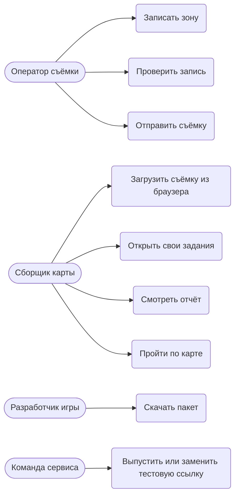
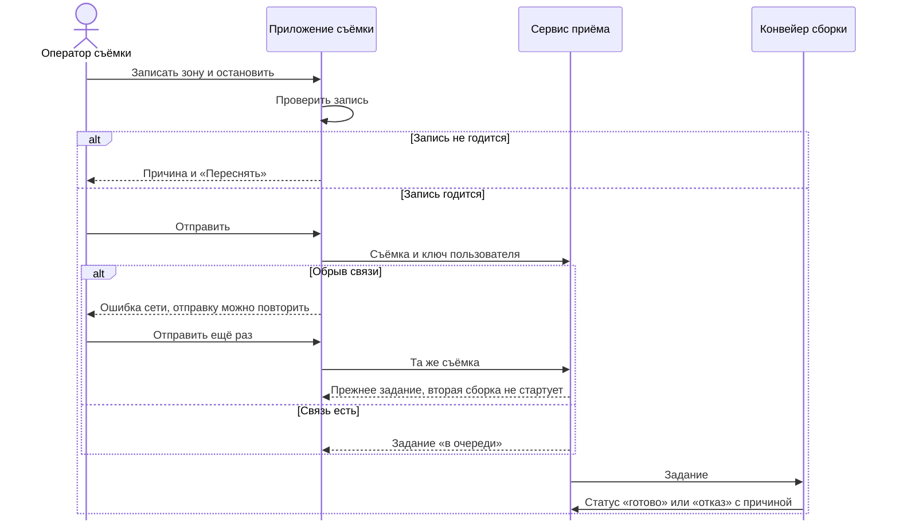
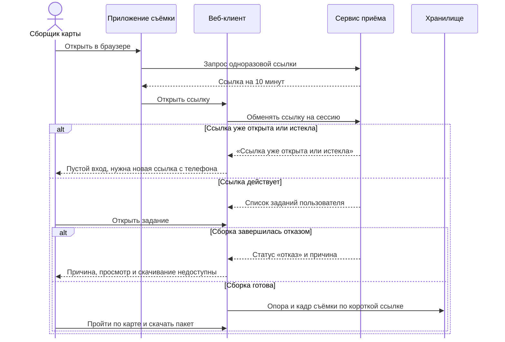

# Приложение 2. Диаграммы

```mermaid
flowchart TB
  subgraph L1[Автор уровня]
    direction LR
    S(( )) --> A1[Снять место в сканере]
    A1 --> A2[Выгрузить плотную модель]
  end
  subgraph L2[3D-художник]
    direction LR
    B1[Почистить и упростить модель] --> B2[Построить опору для персонажа]
    B2 --> B3[Выставить размеры]
  end
  subgraph L3[Разработчик игры]
    direction LR
    C1[Импортировать в движок] --> C2{Персонаж проходит уровень?}
    C2 -- Да --> E((( )))
  end
  A2 --> B1
  B3 --> C1
  C2 -- Нет: брак съёмки --> A1
  C2 -- Нет: брак опоры --> B2
  classDef manual fill:#fde2e1,stroke:#d9534f,color:#111;
  classDef node0 fill:#111,stroke:#111;
  class B1,B2,B3,C2 manual
  class S,E node0
```

Рис. П.2.1. Процесс AS-IS: уровень с реального места сегодня

UML-диаграмма активности с дорожками по ролям. Ручные шаги и поздняя проверка отмечены красным. Все три роли может выполнять один человек.

```mermaid
flowchart TB
  subgraph L1[Оператор съёмки]
    direction LR
    S(( )) --> A1[Обойти зону 10–30 секунд]
    A3[Отправить съёмку]
  end
  subgraph L2[Система NVC Maps]
    direction LR
    B1[Проверить запись на телефоне] --> B2{Запись годится?}
    B2 -- Нет --> B3[Показать причину и «Переснять»]
    B4[Собрать карту на сервере] --> B5{Условия табл. 2.10 выполнены?}
    B5 -- Нет --> B6[Отказ с причиной]
    B5 -- Да --> B7[Пакет и отчёт готовы]
  end
  subgraph L3[Сборщик карты и разработчик игры]
    direction LR
    C1[Пройти по карте в браузере] --> C2{Персонаж проходит?}
    C2 -- Да --> C3[Скачать пакет в движок]
    C3 --> E((( )))
  end
  A1 --> B1
  B2 -- Да --> A3
  A3 --> B4
  B3 --> A1
  B6 --> A1
  B7 --> C1
  C2 -- Нет --> A1
  classDef node0 fill:#111,stroke:#111;
  class S,E node0
```

Рис. П.2.2. Процесс TO-BE: уровень с NVC Maps

UML-диаграмма активности с дорожками по ролям. Ручных шагов доводки нет; брак отсекается проверкой записи и отказом сборки.

Рис. П.2.3. Контекстная диаграмма

Рис. П.2.4. Диаграмма вариантов использования

Рис. П.2.5. Системная диаграмма последовательности UC-1 «Снять и отправить участок»

Рис. П.2.6. Системная диаграмма последовательности UC-2 «Проверить карту в браузере»

```mermaid
flowchart TD
  S(( )) --> A[Открыть «Сканировать»]
  A --> B[Рамка зоны 0,8 × 0,8 м]
  B --> C[Обход 10–30 секунд, стоп]
  C --> D{"Проверка: 10–30 с, путь ≥ 0,28 м, ракурс ≥ 90°, зона ≤ 0,92 м, разрыв поз ≤ 0,5 с"}
  D -- Не пройдена --> E[Причина и «Переснять»]
  E --> A
  D -- Пройдена --> F[Отправить]
  F --> G{Связь есть?}
  G -- Обрыв --> H[Отправить ещё раз]
  H --> I{Съёмка уже на сервере?}
  I -- Да --> J[Вернуть прежнее задание]
  I -- Нет --> K[Создать задание]
  G -- Да --> K
  J --> Q[Задание в очереди]
  K --> Q
  Q --> Z((( )))
  classDef node0 fill:#111,stroke:#111;
  class S,Z node0
```

Рис. П.2.7. Диаграмма активности UC-1 с альтернативными потоками
