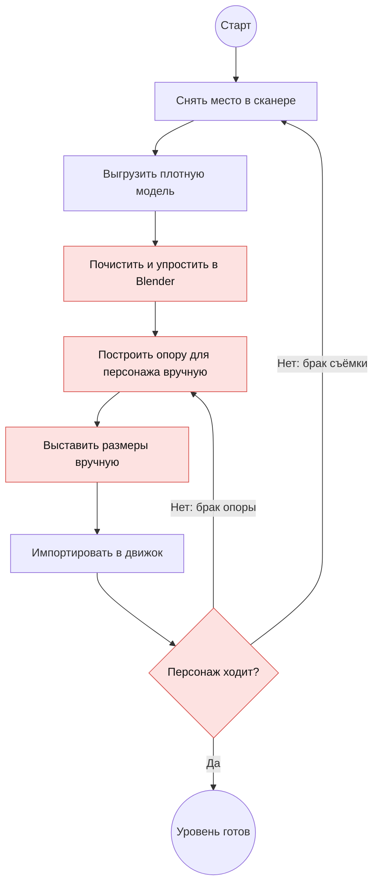
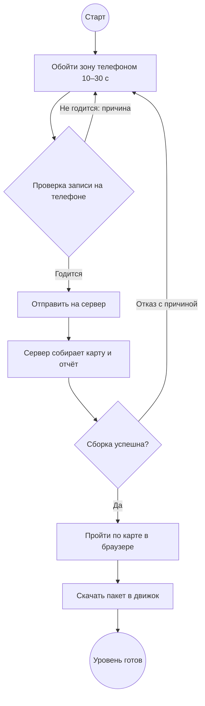
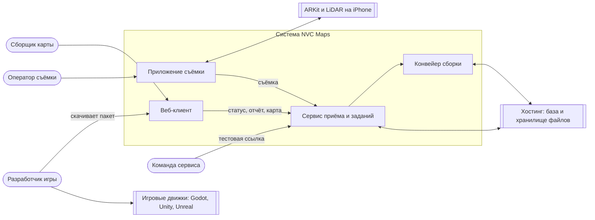
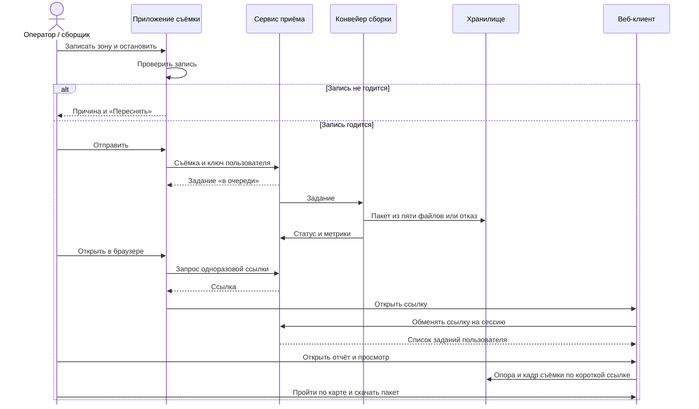
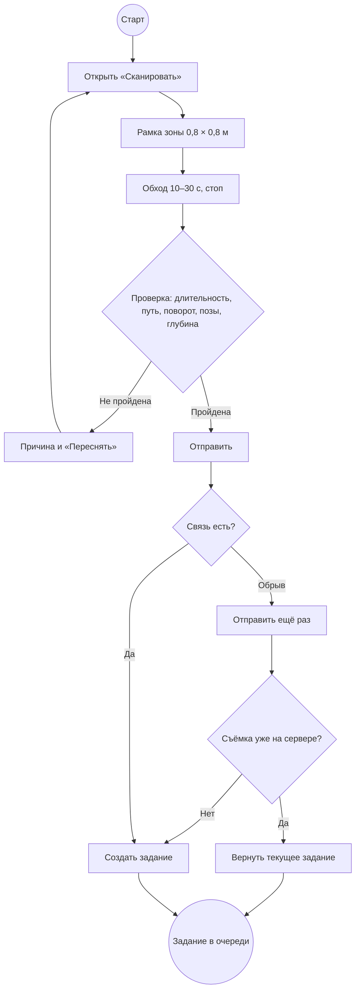

# Приложение 2. Диаграммы

Рис. П.2.1. Процесс AS-IS: уровень с реального места сегодня

UML-диаграмма активности. Ручные шаги и поздняя проверка отмечены красным.

Рис. П.2.2. Процесс TO-BE: уровень с NVC Maps

Рис. П.2.3. Контекстная диаграмма

Рис. П.2.4. Диаграмма вариантов использования

Рис. П.2.5. Системная диаграмма последовательности: UC-1 и UC-2

Рис. П.2.6. Диаграмма активности UC-1 с альтернативными потоками
