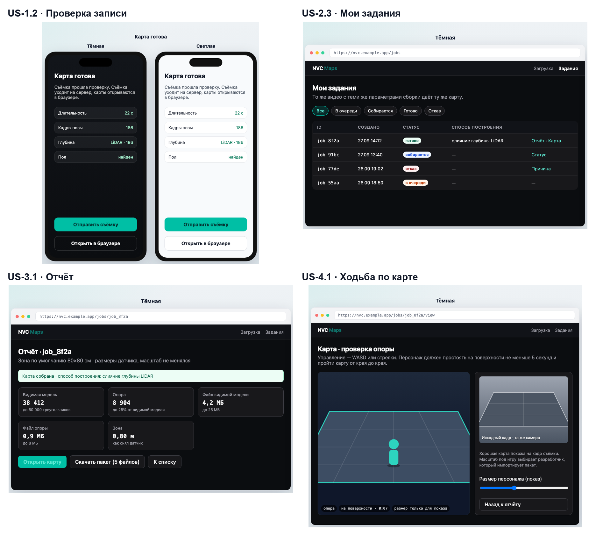
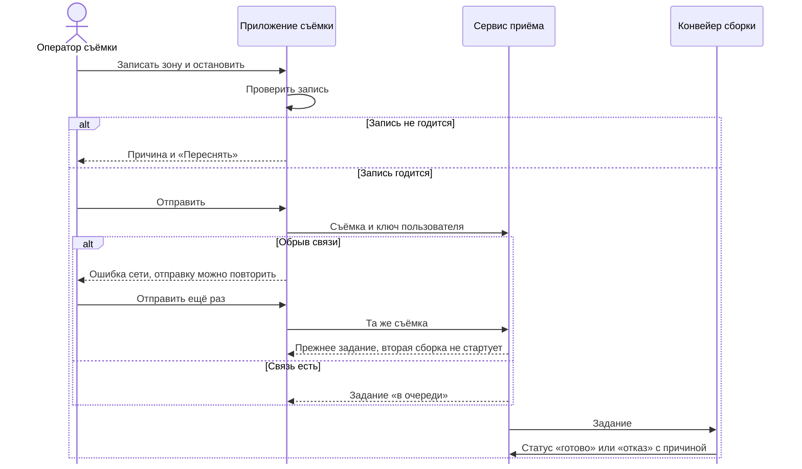
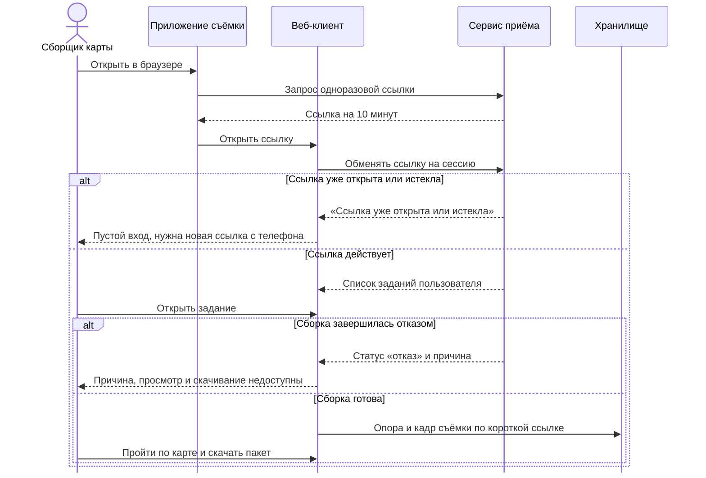

# Бизнес-анализ: система создания игровых 3D-карт по видеозаписи

**Продукт:** NVC Maps
**English:** A System for Creating 3D Game Maps from Video

Сайт с разделами и экранами: [kalashnikovkv.github.io/nvc-business-analysis](https://kalashnikovkv.github.io/nvc-business-analysis/)

Файл собирается скриптом `scripts/build-ba.py` из разделов `00`–`06`. Правки вносятся в разделы, не сюда.

---

## Введение

### Актуальность и проблема

**У кого проблема.** У тех, кто делает небольшие игры и прототипы без 3D-художника. Это инди-разработчики и участники гейм-джемов, level-дизайнеры небольших студий, авторы настольных макетов и диорам, преподаватели и студенты геймдев-курсов. В 2025 году в Steam вышло больше 18 тысяч игр \[1\]. В Fortnite за 2024 год число авторов карт выросло с 24 до 70 тысяч \[2\]. У Roblox к концу 2025 года в программе выплат было больше 35 тысяч авторов \[3\].

**В чём проблема.** Человек хочет сделать уровень с реального места: угла стола, куска пола, макета. Телефон с датчиком глубины LiDAR снимает такое место в метрах \[4\], \[5\]. Но приложения-сканеры отдают модель для просмотра, а не уровень \[6\]–\[9\]. По ней нельзя сразу пустить персонажа. Опору под ноги, упрощение модели, размеры и проверку проходимости делают вручную в 3D-редакторе и движке. Без навыков 3D-моделирования реальное место в прототип не попадает, а с навыками на него уходит много ручной работы. Плохая съёмка при этом выглядит как удачная: сканер выдаёт модель всегда, и брак становится виден только в движке.

**Почему сейчас.** LiDAR есть во всех iPhone Pro начиная с iPhone 12 Pro и в iPad Pro \[5\], \[10\]. Формат glTF 2.0 открывают браузер и популярные игровые движки \[11\]. Число людей, которые делают игры и карты, растёт \[1\]–\[3\]. Методы, на которых строится автоматическая сборка, — объёмное слияние глубины, построение поверхности и упрощение сетки — давно отработаны \[12\]–\[15\]. Не хватает продукта, который соберёт их в путь «снял — прошёл по уровню».

**Решение.** NVC Maps — сервис, который превращает короткую съёмку участка на iPhone с датчиком глубины в игровой уровень. Приложение на телефоне записывает и проверяет съёмку, сервер собирает из неё видимую модель и отдельную опору для персонажа, а в браузере по карте можно пройти до того, как забрать её в игровой движок. Непригодная съёмка получает отказ с причиной.

### Цель и задачи

**Цель.** Сократить путь от съёмки реального участка до проходимого игрового уровня до одного обхода телефоном, без ручной доводки геометрии.

**Задачи.**

1. Выявить, где в нынешнем пути от съёмки до уровня теряются время и данные.
2. Определить, чего не хватает существующим сканерам и исследовательским решениям, чтобы сразу получить проходимый уровень.
3. Задать измеримые показатели успеха с базовыми и целевыми значениями.
4. Описать, что делает пользователь, что проверяет система и в каких случаях она отказывает в сборке.
5. Определить набор эталонных съёмок и проверок, по которым принимается результат, а также правовые ограничения и риски.

### Объект и предмет

**Объект** — процесс создания игрового уровня по реальному месту: от съёмки до первой проверки уровня в игровом движке.

**Предмет** — автоматизируемая часть этого процесса: проверка съёмки, сборка карты с отдельной опорой для персонажа, проверка проходимости в браузере и выдача пакета для движков.

### Методы

Требования собраны так:

- **Анализ документов.** Техническое задание и чертёж пайплайна проекта, спецификация glTF 2.0 \[11\], документация ARKit и RoomPlan \[16\], регламент GDPR \[17\], WCAG 2.1 \[18\].
- **Обзор литературы.** Научные работы по реконструкции поверхности, упрощению сеток и превращению видео в интерактивные сцены \[4\], \[12\]–\[15\], \[19\]–\[22\].
- **Бенчмаркинг аналогов.** Сравнение девяти решений по открытым описаниям, документации и ценам \[6\]–\[9\], \[16\], \[19\], \[23\], \[24\] (раздел 1.3).
- **Прото-персона.** Персона построена по результатам анализа документов и рынка. Интервью с пользователями не проводились; проверка персоны на реальных людях вынесена в риски (раздел 2.9).

Техники описаны по BABOK v3 \[25\]: анализ документов, бенчмаркинг и анализ рынка, моделирование процессов, user stories, приоритизация MoSCoW.

### Термины

| Термин | Что значит |
|--------|------------|
| Съёмка (capture) | Запись участка на телефоне: видео, позы камеры, служебные данные и кадры глубины одним файлом |
| Позы камеры | Где был телефон и куда смотрел в каждый момент записи |
| Видимая модель (visual mesh, `map.glb`) | Та часть карты, которую видит игрок |
| Способ построения | Как сервер получил поверхность; для пригодной съёмки — слияние глубины LiDAR |
| Опора (collision mesh, `collision.glb`) | Невидимая упрощённая модель, по которой ходит персонаж |
| Пакет карты | Пять файлов: видимая модель, опора, манифест, границы, отчёт |
| Задание (job) | Одна сборка карты на сервере со статусом «в очереди», «собирается», «готово» или «отказ» |
| Отказ | Ответ сервиса «карту собрать нельзя» с текстом причины вместо карты |
| Эталонная съёмка (reference capture) | Одна из четырёх сохранённых съёмок для приёмки: две пригодные и две непригодные |
| Проверка ходьбой | Проход персонажем по опоре в браузере до выдачи пакета |

---

## 1. Аналитическая часть

### 1.1. Текущее состояние

#### Как задачу решают сейчас (AS-IS)

Готового пути «снял место — получил уровень» нет. Человек собирает его сам из нескольких инструментов. Процесс показан на диаграмме активности (рис. П.2.1).

Шаги, участники и потери текущего процесса приведены в табл. 1.1.

Табл. 1.1. Шаги текущего процесса и потери

| Шаг | Кто | Инструмент | Где теряются время и данные |
|-----|-----|------------|-----------------------------|
| 1. Снять место | Автор уровня | Сканер на телефоне: Polycam, Scaniverse, KIRI Engine | Приложение не сообщает, годится ли съёмка для игрового уровня |
| 2. Выгрузить модель | Автор уровня | Экспорт OBJ, FBX или GLB; часть форматов только в платном тарифе \[26\] | Плотная модель с мусором по краям, без игрового бюджета |
| 3. Почистить и упростить | Автор уровня или 3D-художник | Blender | Ручная работа, нужны навыки. Размеры легко сбить при экспорте |
| 4. Сделать опору для персонажа | То же | Blender или движок | Отдельная упрощённая модель руками. Сплат не держит персонажа, опору всё равно строят отдельно \[7\] |
| 5. Импортировать в движок и пройти | Разработчик | Godot, Unity, Unreal | Проходимость видна только здесь. Ошибку на шаге 1 или 4 находят в самом конце |
| 6. Переделать | Все | Все инструменты | Повторить тот же результат нельзя: каждый шаг ручной |

**Кто участвует.** Чаще всего один человек: инди-разработчик, level-дизайнер, автор макета или студент. В студии шаги 3–4 может делать 3D-художник, тогда добавляется передача файлов между людьми.

**Где теряется время.** Шаги 3–4: ручная чистка, упрощение и сборка опоры. Шаги 5–6: брак съёмки обнаруживают последним, и цикл повторяется с начала.

**Где теряются данные.** Размеры в метрах, которые измерил датчик, пропадают при экспорте и ручном масштабировании. Сведения о том, как снимали (путь камеры, глубина), в модель не попадают. Объяснить, почему уровень получился плохим, потом нельзя.

#### Условный пример

Персона Аня (раздел 2.2) участвует в гейм-джеме на 48 часов. Тема — «маленький мир», и она хочет сделать уровень из своего письменного стола с книгами и кружкой. Она снимает стол в Polycam и получает красивую модель на несколько сотен тысяч треугольников. Godot импортирует её, но персонаж проваливается: у модели нет отдельной опоры, а края стола рваные. Аня открывает Blender, вручную чистит края, упрощает модель и строит из кубов невидимую опору. При экспорте размеры сбиваются, и персонаж оказывается ростом с кружку. После второй попытки выясняется, что одна книга не попала в съёмку: Аня снимала слишком быстро. На уровень уходит полдня из 48 часов джема, и в итоге она заменяет стол кубами.

Этот пример показывает три потери: время на ручную доводку, поздно найденный брак съёмки и сбитые размеры. Именно их закрывает продукт.

#### Как будет (TO-BE)

Человек обходит участок телефоном 10–30 секунд. Приложение сразу проверяет запись и либо отправляет её на сервер, либо просит переснять с понятной причиной. Сервер сам собирает карту: видимую модель, отдельную лёгкую опору и отчёт, сохраняя размеры датчика. Человек проходит по карте в браузере и скачивает пакет в движок. Ручные шаги 3–4 и поздняя проверка 5 исчезают (рис. П.2.2).

### 1.2. Обзор источников

Использованы 33 источника, из них 10 научных. Источники разбиты на четыре группы: методы реконструкции, представление сцены, стандарты и правила, рынок и аналоги.

**Методы реконструкции.** Классический путь от глубины к поверхности описан в работах Курлесса и Левоя \[13\] и в KinectFusion \[12\]: карты глубины с известным положением камеры накапливаются в объёмной сетке, из которой поверхность извлекается алгоритмом marching cubes \[14\]. Метод устойчив к шуму отдельного кадра, но полностью зависит от точности поз: ошибка траектории размазывает поверхность. Отсюда два решения продукта. Позы камеры обязательны, и без них сборка честно отказывает. Участок съёмки маленький, чтобы накопленная ошибка траектории не успевала вырасти. Упрощение по квадрикам \[15\] позволяет уменьшить сетку до заданного числа треугольников с контролируемой потерей формы — это основа жёстких бюджетов видимой модели и опоры.

**Точность датчика.** Оценка LiDAR iPhone 12 Pro \[4\] показывает, что датчик даёт сантиметровую точность на небольших объектах при съёмке с расстояния до нескольких метров. Это согласуется с выбором небольшой зоны около 80×80 см и съёмки с небольшой высоты. Depth Anything V2 \[21\] оценивает глубину по одному кадру нейросетью; это оценка, а не измерение датчиком, поэтому в продукте такой способ — только запасной выключенный режим.

**Представление сцены.** Gaussian splatting \[20\] дал фотореалистичный просмотр сцен в реальном времени, и сканеры быстро его подхватили \[6\], \[7\], \[23\]. Но у сплата нет поверхности, по которой может пройти персонаж: даже в инструкциях Polycam для Unreal опора для персонажа берётся из отдельной модели \[7\]. Video2Game \[19\] — самая близкая к продукту работа: видео превращается в сцену с опорой для персонажа, которая работает в браузере. Однако она требует обучения нейронного представления для каждой сцены и остаётся исследовательским конвейером, а не сервисом. Вывод для продукта: красивая картинка и пригодная для игры опора — разные задачи, и продукт решает вторую.

**Стандарты и правила.** glTF 2.0 \[11\] задаёт метры как единицу и ось Y вверх и читается браузером и движками — это делает пакет переносимым без конвертации. GDPR \[17\] требует правового основания, минимизации данных и права на удаление: съёмка помещения может случайно захватить людей. WCAG 2.1 \[18\] задаёт измеримый уровень доступности веб-клиента. Техники выявления требований взяты из BABOK v3 \[25\].

Что из каждой группы источников следует для требований главы 2, показано в табл. 1.2.

Табл. 1.2. Выводы из источников для требований

| Источники | Что из них следует | Где в требованиях |
|-----------|--------------------|-------------------|
| Слияние глубины \[12\], \[13\], Open3D \[22\] | Карты глубины с известными позами сливаются в поверхность; без поз результат не собрать. Готовые реализации открыты (MIT) | Позы обязательны, иначе отказ: US-3.2; лицензии: 2.8 |
| Marching cubes \[14\], упрощение по квадрикам \[15\] | Поверхность строится автоматически, число треугольников можно жёстко ограничить | Бюджет карты: KPI-4, US-3.3 |
| LiDAR iPhone 12 Pro \[4\], устройства \[5\], \[10\] | Сантиметровая точность на небольшом участке; глубина есть только на Pro-устройствах Apple | Зона 80×80 см, платформа iOS: 2.3 |
| Gaussian splatting \[20\], сплаты в движках \[7\], \[23\] | У сплата нет физической поверхности; опору добавляют отдельной моделью | Отдельная опора: US-5.1; сплаты вне релиза |
| Depth Anything V2 \[21\] | Глубина по одному кадру — оценка нейросети, а не измерение | Сборка без LiDAR — выключенный режим: 2.3 |
| Video2Game \[19\] | Видео превращается в интерактивную сцену с опорой, но ценой обучения сцены; это исследование, а не продукт | Ходьба в браузере: US-4.1; без обучения нейросети на каждую сцену |
| glTF 2.0 \[11\], RoomPlan \[16\] | Открытый формат с метрами и осью Y вверх; RoomPlan строит план помещения, а не поверхность участка | Пакет GLB и манифест: US-5.2 |
| GDPR \[17\], WCAG 2.1 \[18\], BABOK \[25\] | Правовое основание, минимизация, удаление; доступность AA; техники выявления требований | 2.8, NFR-9; методы во введении |
| Рынок \[1\]–\[3\], аналоги \[6\]–\[9\], \[23\], \[24\] | Авторов игр много и больше с каждым годом; сканеры отдают модель, а не уровень | Сегменты: 2.2; аналоги: 1.3 |

**Вывод.** Технологии сборки поверхности и упрощения зрелые \[12\]–\[15\], \[22\]. Датчик телефона точен на небольшом участке \[4\]. Новизна продукта не в алгоритмах, а в том, чтобы связать их в проверяемый путь от съёмки до проходимого уровня с честным отказом.

### 1.3. Анализ аналогов

Рассмотрены девять решений. Коммерческие: Polycam \[7\] (подписка около 27 $ в месяц \[26\]), Scaniverse \[6\] (Niantic Spatial), KIRI Engine \[8\] (50–80 $ в год), RealityScan \[9\] (Epic Games, выгрузка через Sketchfab в Unreal), Luma \[23\] (сплаты, плагин Unreal), World Labs Marble \[24\] (генерирует 3D-мир из текста, фото или видео и отдаёт опору в GLB), а также API Apple RoomPlan \[16\], который строит план комнаты из стен и мебели. Исследовательские и открытые: Video2Game \[19\] и ручной путь на COLMAP \[27\], Open3D \[22\] и Blender.

**Polycam** — распространённый сканер с LiDAR и фотограмметрией. Сильная сторона — качество модели и широкий выбор форматов. Для уровня из него нужна ручная доводка: опоры нет, модель плотная, часть форматов только в платном тарифе \[26\].

**Scaniverse** — бесплатный сканер Niantic Spatial с моделями и сплатами. В 2026 году добавил пакет для симуляторов роботов, где модель строится из сплата \[6\], \[28\]. Это шаг к «пригодной для симуляции» сцене, но не к лёгкому игровому уровню.

**KIRI Engine** ориентирован на художников: ретопология, PBR-материалы, экспорт в Blender и Unreal \[8\]. Результат — ассет для дальнейшей работы, а не проходимый участок.

**RealityScan** от Epic Games превращает фотографии объекта в 3D-модель и ведёт её в экосистему Epic: Sketchfab и Unreal \[9\].

**Luma** делает фотореалистичные сплаты и плагин для Unreal \[23\]. У сплата нет поверхности для персонажа \[20\], метрические размеры производитель не заявляет.

**World Labs Marble** ближе всего по выходу: отдаёт отдельную опору в GLB \[24\]. Но мир генерируется моделью, а не измеряется, поэтому его размеры не настоящие; проверку проходимости и отказ на непригодной съёмке производитель не заявляет \[24\].

**Apple RoomPlan** строит план помещения из стен, дверей и мебели \[16\]. Это схема комнаты, а не поверхность стола или макета.

**Video2Game** доказывает, что путь «видео → проходимая сцена» возможен \[19\], но требует обучения на каждую сцену и не является продуктом.

**Ручной путь** на COLMAP \[27\], Open3D \[22\] и Blender даёт полный контроль, но требует навыков и времени и не повторяется одной командой.

#### Сравнение по критериям

Критерии выведены из потерь текущего процесса (табл. 1.1): каждому шагу, на котором теряются время или данные, соответствует один критерий, а последний показывает, в чём аналоги сильнее.

- **Отказ** (шаг 1) — отказ с причиной на съёмке, непригодной для уровня.
- **Бюджет** (шаги 2–3) — модель укладывается в игровой бюджет без ручного упрощения.
- **Метры** (шаг 3) — в результате сохраняются настоящие размеры.
- **Опора** (шаг 4) — отдельная лёгкая модель, по которой ходит персонаж.
- **Ходьба** (шаг 5) — проходимость можно проверить до импорта в движок.
- **Повтор** (шаг 6) — повторная обработка той же съёмки даёт тот же результат.
- **Картинка** — высокое качество картинки и текстур.

Оценки аналогов — по открытым описаниям и документации \[6\]–\[9\], \[19\], \[23\], \[24\]. Колонка NVC Maps — целевые значения: продукт в разработке. Результаты сведены в табл. 1.3.

<!-- landscape -->

Табл. 1.3. Сравнение аналогов по критериям

| Критерий | Polycam | Scaniverse | KIRI Engine | RealityScan | Luma | World Labs Marble | Video2Game | NVC Maps (цель) |
|----------|---------|------------|-------------|-------------|------|-------------------|------------|-----------------|
| Отказ (шаг 1) | — | — | — | — | — | — | — | ✓ |
| Бюджет (шаги 2–3) | — | — | ~ | — | — | — | — | ✓ |
| Метры (шаг 3) | ✓ | ✓ | ✓ | — | — | ✕ | — | ✓ |
| Опора (шаг 4) | ✕ | ~ | — | — | ✕ | ✓ | ✓ | ✓ |
| Ходьба (шаг 5) | — | — | — | — | — | ~ | ✓ | ✓ |
| Повтор (шаг 6) | — | — | — | — | — | — | — | ✓ |
| Картинка | ✓ | ✓ | ✓ | ✓ | ✓ | ✓ | ✓ | ✕ |

Обозначения: ✓ — есть; ~ — частично; ✕ — нет; — — производитель не заявляет. Пояснения: Scaniverse отдаёт модель для симуляторов роботов \[28\]; KIRI Engine делает ретопологию \[8\]; у World Labs Marble есть пример с физикой в браузере \[24\]; у Polycam и Luma опору для персонажа добавляют отдельной моделью \[7\], \[20\].

<!-- /landscape -->

#### Чего не хватает

1. **Опоры для персонажа в метрах.** Сканеры с LiDAR сохраняют размеры, но отдельную опору не заявляют, а у Polycam её добавляют вручную \[7\]. World Labs Marble отдаёт опору, но мир сгенерирован моделью, и его размеры не настоящие.
2. **Проверки проходимости до движка.** Её заявляет исследовательский Video2Game и частично World Labs Marble; сканеры такую проверку не заявляют.
3. **Честного отказа.** Ни одно решение не заявляет отказ с причиной на съёмке, непригодной для уровня.
4. **Повторяемости и игрового бюджета.** Ни одно решение не заявляет повторяемость результата и автоматическое укладывание в игровой бюджет.

**Где аналоги сильнее.** Качество картинки, текстуры, размер сцены (комната, улица), поддержка Android. Продукт сознательно уступает им здесь: его цель — пригодность результата для игры.

### 1.4. Выводы по главе

Выявленные проблемы и то, что должно уметь новое решение, сведены в табл. 1.4.

Табл. 1.4. Проблемы и их связь с эпиками и KPI

| № | Проблема | Что должно уметь новое решение | Эпик | KPI |
|---|----------|-------------------------------|------|-----|
| П1 | Плохая съёмка выглядит как удачная, брак находят в движке | Проверить запись на телефоне и отказать с причиной | E1, E3 | KPI-3 |
| П2 | Опору для персонажа и упрощение делают руками | Собрать видимую модель и лёгкую опору автоматически | E3, E5 | KPI-1, KPI-4 |
| П3 | Проходимость видна только в движке | Дать пройти по карте в браузере | E4 | KPI-1, KPI-2 |
| П4 | Размеры датчика теряются по дороге | Сохранить метры и записать единицы и оси в манифест | E5 | KPI-1 |
| П5 | Путь от съёмки до уровня долгий и не повторяется | Принять съёмку, собрать карту на сервере, показать статус | E2, E3 | KPI-2 |
| П6 | Без телефона с LiDAR продукт не проверить | Открыть эталонные задания по тестовой ссылке | E6 | KPI-1, KPI-3 |

---

## 2. Требования к системе

### 2.1. Видение и цели

#### Видение

NVC Maps превращает короткое видео реального места в игровой уровень. Человек обходит небольшой участок с iPhone, а сервис сам собирает карту, по которой персонаж может ходить, проверяет её в браузере и отдаёт файлом для любого движка. Плохая съёмка получает честный отказ с причиной, а не кривую карту.

#### Бизнес-цели

Бизнес-цели перечислены в табл. 2.1.

Табл. 2.1. Бизнес-цели

| ID | Цель |
|----|------|
| BG-1 | Убрать ручную доводку геометрии из пути от съёмки до проходимого уровня |
| BG-2 | Сократить время от съёмки до первой проверки уровня |
| BG-3 | Не выдавать непригодную съёмку за готовую карту |
| BG-4 | Отдавать карту, которая сразу укладывается в игровой бюджет |

#### KPI

Достижение целей измеряется четырьмя KPI (табл. 2.2).

Табл. 2.2. KPI: базовые и целевые значения

| ID | Показатель | Базовое значение (сейчас) | Целевое значение | Как измерить |
|----|-----------|---------------------------|------------------|--------------|
| KPI-1 | Доля пригодных эталонных съёмок, по которым получен проходимый уровень без ручной доводки | 0%: сканеры не отдают опору для персонажа (раздел 1.3) | 100% на эталонных съёмках S1, S2 | Прогон эталонов, проверка ходьбой: персонаж стоит ≥ 5 с и проходит карту от края до края |
| KPI-2 | Время от отправки съёмки до первой проверки ходьбой | 2–4 ч по ручному пути AS-IS (оценка автора, шаги 2–5 раздела 1.1) | ≤ 15 мин | Время между отправкой и открытием карты в браузере на эталонах |
| KPI-3 | Доля непригодных съёмок, получивших отказ с причиной | 0%: сканеры выдают модель при любой съёмке | 100% на эталонных съёмках N1, N2 | Прогон эталонов, текст причины в отчёте |
| KPI-4 | Вес карты | Плотный скан без упрощения: сотни тысяч треугольников (оценка автора по ручному пути, раздел 1.1) | Видимая модель ≤ 50 000 треугольников; опора ≤ 25% от видимой модели и ≥ 100 граней | Метрики в отчёте сборки |

### 2.2. Стейкхолдеры и пользователи

#### Стейкхолдеры

Стейкхолдеры, их интерес и влияние приведены в табл. 2.3.

Табл. 2.3. Стейкхолдеры: интерес и влияние

| Стейкхолдер | Интерес | Интерес (H/M/L) | Влияние (H/M/L) |
|-------------|---------|-----------------|-----------------|
| Пользователи: инди-разработчики, level-дизайнеры, авторы макетов, преподаватели и студенты | Быстро получить проходимый уровень с реального места | H | H |
| Владелец продукта и команда | Продукт снимает боль пользователей и работает без ручного вмешательства; команда ведёт сервис и тестовую ссылку | H | H |
| Apple: iOS, ARKit, LiDAR, App Store | Приложение по правилам App Store, понятный запрос доступа к камере | L | H |
| Игровые движки и стандарт glTF: Godot, Unity, Unreal, Khronos Group | Корректные файлы в открытом формате | L | H |
| Надзор за персональными данными (GDPR) | Лица и чужие помещения не попадают в данные без основания | L | H |
| Хостинг-провайдер | Ресурсы в пределах тарифа и лимитов | L | M |
| Авторы открытых библиотек и моделей: Open3D, PyTorch, Depth Anything | Соблюдение лицензий | L | M |
| Конкуренты: Polycam, Scaniverse, KIRI, RealityScan, Luma, World Labs | Задают ожидания пользователей от сканера | M | M |
| Сообщества: itch.io и гейм-джемы, курсы геймдева, Fortnite Creative, Roblox | Инструменты, которые ускоряют создание игр; канал к пользователям | M | L |
| Игрок на готовой карте | Не провалиться сквозь пол | H | L |
| Владелец снимаемого места | Знать о съёмке и иметь право отказать | H | L |
| Человек, случайно попавший в кадр | Не оказаться в чужих материалах | H | L |

С группами H/H согласуются границы релиза и критерии успеха. Правила групп L/H соблюдаются как ограничения: App Store, glTF, GDPR. Интересы групп H/L защищаются правилами продукта: проверкой ходьбой, правилами съёмки, запретом лиц крупным планом.

#### Пользователи системы (акторы)

- **Оператор съёмки** — снимает участок, проходит проверку записи, отправляет съёмку.
- **Сборщик карты** — следит за заданиями, читает отчёт, проходит по карте в браузере.
- **Разработчик игры** — скачивает пакет и забирает его в движок.
- **Команда сервиса** — выпускает и меняет тестовую ссылку на эталонные задания.

Обычно первые три роли выполняет один человек. Диаграмма вариантов использования — рис. П.2.4.

#### Персона

Персона построена по результатам анализа документов и рынка (введение, «Методы»). Её проверка на интервью вынесена в риски (R6).

**Аня, 24 года, инди-разработчица.** Делает небольшие игры на Godot в свободное время, участвует в гейм-джемах на 48–72 часа. 3D-модели берёт из бесплатных библиотек, в Blender работает с трудом. Есть iPhone 15 Pro.

- **Цель:** за пару часов джема получить уровень с настоящей фактурой, например со своего письменного стола.
- **Боль:** сканер даёт красивую модель, но персонаж по ней не ходит; на сборку опоры уходит вечер, которого на джеме нет.
- **Как продукт помогает:** обход стола за 30 секунд, проверка ходьбой в браузере, GLB сразу в Godot.

### 2.3. Границы проекта

#### Входит в релиз

- Съёмка на iPhone или iPad с LiDAR: зона около 80×80 см, обход, проверка записи, отправка на сервер.
- Сборка карты в размерах датчика: видимая модель, лёгкая опора, манифест, границы, отчёт.
- Отказ с причиной на непригодной съёмке вместо произвольной геометрии.
- Приём съёмки, очередь заданий, статус, хранение пакета.
- Браузер: загрузка съёмки, список своих заданий, отчёт, ходьба по опоре рядом с кадром съёмки, скачивание пакета.
- Вход в браузер одноразовой ссылкой с телефона; тестовая ссылка на четыре эталонных задания.
- Открытое описание обмена: что принимается и что отдаётся.

#### Не входит в релиз

- Полноценная игра и обязательная демонстрация в Unreal.
- Масштабирование карты под конкретного персонажа.
- Текстуры, второй уровень детализации, сплаты.
- Обучение собственной модели глубины; сборка без LiDAR влияет на релиз только как выключенный режим.
- Android как платформа релиза.
- Панель администрирования, учётные записи, роли, просмотр чужих карт.

#### Допущения и ограничения

Допущения и ограничения проекта приведены в табл. 2.4.

Табл. 2.4. Допущения и ограничения

| Тип | Описание | Следствие |
|-----|----------|-----------|
| Ресурсы | Продукт делает один разработчик | При нехватке времени первыми выпадают истории Should и Could (раздел 2.5) |
| Сроки | Срок первого релиза фиксирован календарём проекта | Объём ограничен Must-историями; всё остальное — после релиза |
| Устройства | Для съёмки нужен iPhone Pro или iPad Pro с LiDAR \[5\], \[10\]; симулятор и браузер глубину не дают | Без устройства продукт проверяют по четырём эталонным съёмкам и тестовой ссылке |
| Доступ к данным | Используются только собственные съёмки автора и четыре эталона: две пригодные, две непригодные. Чужих датасетов нет | Согласие организаций не требуется (заявления); проверка ограничена эталонами |
| API и платформа | Глубина и позы — только через ARKit на устройстве \[29\]; формат карты — glTF 2.0 \[11\] | Платформа релиза — iOS; пакет в GLB |
| Вычисления | Размер участка ограничен объёмом вычислений сервера: по умолчанию 80×80 см | Пороги качества заданы для этого размера |

### 2.4. Концепция решения

Решение состоит из четырёх частей (рис. П.2.3):

1. **Приложение съёмки на iPhone.** Пишет видео, позы камеры, служебные данные и глубину LiDAR, проверяет запись и отправляет её на сервер. Адрес сервера и ключ пользователя хранятся в приложении.
2. **Сервис приёма.** Принимает съёмку с телефона или из браузера, ставит задание в очередь, хранит задания, метрики и ссылки на файлы. Повторная отправка той же съёмки возвращает текущее задание.
3. **Конвейер сборки.** Отдельный серверный процесс берёт задание из очереди, собирает пакет из пяти файлов и кладёт его в хранилище. При непригодной съёмке пишет отказ с причиной.
4. **Веб-клиент.** Показывает задания этого пользователя, отчёт и ходьбу по опоре рядом с кадром съёмки. Вход — одноразовой ссылкой с телефона или многоразовой тестовой ссылкой на эталонные задания.

Внешние системы: ARKit на устройстве, хостинг с базой и хранилищем файлов, игровые движки, которые открывают пакет.

#### Альтернативы

Две альтернативы сравниваются в табл. 2.5.

Табл. 2.5. Сравнение альтернатив концепции

| Критерий | А. Сборка на телефоне | Б. Сборка на сервере и проверка в браузере (выбрано) |
|----------|-----------------------|-----------------------------------------------------|
| Вычисления | Ограничены ресурсами телефона: слияние глубины и упрощение всей поверхности выполняются на устройстве | Сервер собирает без ограничений устройства; размер участка настраивается |
| Повторяемость | Результат зависит от модели телефона и версии приложения | Один сборщик и одни настройки для всех съёмок |
| Проверка без телефона | Невозможна: без LiDAR-устройства продукт не проверить | Эталонные задания по тестовой ссылке |
| Проверка ходьбой | Только на телефоне, мелко и неудобно | В браузере на большом экране рядом с кадром съёмки |
| Приватность | Данные не покидают телефон | Данные хранятся на сервере: нужны правовое основание и удаление (2.8) |
| Стоимость | Нет затрат на сервер | Затраты на хостинг |

**Обоснование выбора.** Вариант Б выигрывает в повторяемости, проверке без устройства и удобстве проверки ходьбой. Это прямо поддерживает KPI-1–KPI-3. Минусы варианта — приватность и стоимость — закрыты требованиями 2.8 и рисками R4, R5.

### 2.5. Функциональные требования

#### Эпики

Эпики и их связь с бизнес-целями и KPI приведены в табл. 2.6.

Табл. 2.6. Эпики и их связь с целями

| Эпик | Название | Бизнес-цель | KPI |
|------|----------|-------------|-----|
| E1 | Съёмка и проверка записи | BG-3 | KPI-3 |
| E2 | Отправка и задания | BG-2 | KPI-2 |
| E3 | Сборка, отчёт и качество | BG-1, BG-3, BG-4 | KPI-1, KPI-3, KPI-4 |
| E4 | Проверка ходьбой в браузере | BG-1, BG-2 | KPI-1, KPI-2 |
| E5 | Пакет для движка | BG-1, BG-4 | KPI-1, KPI-4 |
| E6 | Ведение сервиса | BG-2 | KPI-1, KPI-3 |

Критерии приёмки записаны в формате «Дано / Когда / Тогда» (Given / When / Then). Полный бэклог одной таблицей — в приложении 1.

Макеты ключевых историй US-1.2, US-2.3, US-3.1 и US-4.1 — на рис. 2.1; все экраны — на сайте проекта.

#### E1. Съёмка и проверка записи

Истории эпика и критерии приёмки — в табл. 2.7.

Табл. 2.7. Истории эпика E1. Съёмка и проверка записи

| ID | История | Критерии приёмки | MoSCoW |
|----|---------|------------------|--------|
| US-1.1 | **Запись зоны.** **Как** оператор съёмки, **я хочу** записать участок на телефоне с LiDAR, **чтобы** получить съёмку с глубиной в метрах. | 1) **Дано** телефон с LiDAR и камера отслеживает положение, **когда** оператор начинает запись, **тогда** на полу фиксируется зона 0,8 × 0,8 м. 2) **Дано** запись остановлена, **когда** съёмка сохраняется, **тогда** в ней есть видео, позы камеры, служебные данные и кадры глубины. 3) **Дано** камера ещё не отслеживает положение, **когда** оператор пытается начать запись, **тогда** кнопка «Запись» недоступна и показана подсказка «AR инициализируется — медленно поводите камерой над полом». 4) **Дано** запись идёт 30 с, **когда** время истекает, **тогда** запись останавливается сама. | Must |
| US-1.2 | **Проверка записи до отправки.** **Как** оператор съёмки, **я хочу** сразу узнать, годится ли запись, **чтобы** не отправлять брак и переснять на месте. | 1) **Дано** запись 10–30 с, путь камеры ≥ 0,28 м, смена ракурса ≥ 90°, ширина зоны ≤ 0,92 м и разрыв между позами ≤ 0,5 с, **когда** проверка завершена, **тогда** показано «Карта готова» и кнопка «Отправить». 2) **Дано** запись короче 10 с, **когда** проверка завершена, **тогда** показано «Запись должна длиться от 10 до 30 секунд». 3) **Дано** путь камеры меньше 0,28 м, **когда** проверка завершена, **тогда** показано «Нужен обход зоны: пройдите вокруг участка». 4) **Дано** смена ракурса меньше 90°, **когда** проверка завершена, **тогда** показано «Слишком одинаковые ракурсы — пройдите вокруг и покажите все стороны». 5) **Дано** ширина зоны больше 0,92 м, **когда** проверка завершена, **тогда** показано «Зона слишком большая — снимите участок около 80×80 см». 6) **Дано** разрыв между позами больше 0,5 с, **когда** проверка завершена, **тогда** показано «Слишком большой разрыв между кадрами — переснимите плавнее». 7) **Дано** любая проверка не пройдена, **когда** оператор смотрит результат, **тогда** вместо «Отправить» доступна только «Переснять». | Must |
| US-1.3 | **Подсказка обхода.** **Как** оператор съёмки, **я хочу** видеть во время записи, сколько ещё обойти, **чтобы** снять участок с первого раза. | 1) **Дано** запись идёт 5 с и больше, **когда** путь камеры меньше 0,28 м, **тогда** на экране видна подсказка «Не стойте на месте — медленно обойдите круг вокруг зоны». | Should |

#### E2. Отправка и задания

Истории эпика и критерии приёмки — в табл. 2.8.

Табл. 2.8. Истории эпика E2. Отправка и задания

| ID | История | Критерии приёмки | MoSCoW |
|----|---------|------------------|--------|
| US-2.1 | **Отправка с телефона.** **Как** оператор съёмки, **я хочу** отправить запись на сервер одной кнопкой, **чтобы** сборка началась без ручной команды. | 1) **Дано** проверка пройдена, **когда** оператор нажимает «Отправить», **тогда** создаётся задание со статусом «в очереди». 2) **Дано** отправка не удалась из-за сети, **когда** приходит ошибка, **тогда** причина показана текстом и отправку можно повторить. 3) **Дано** задание по этой съёмке уже создано, **когда** оператор после ошибки сети отправляет ту же съёмку ещё раз, **тогда** возвращается то же задание и вторая сборка не стартует. 4) **Дано** у пользователя уже идут три сборки, **когда** он отправляет ещё одну съёмку, **тогда** задание не создаётся и показано «Дождитесь окончания текущих сборок: их уже три». | Must |
| US-2.2 | **Загрузка из браузера.** **Как** сборщик карты, **я хочу** загрузить сохранённую съёмку формой в браузере, **чтобы** собрать карту без телефона. | 1) **Дано** открыта форма загрузки, **когда** выбран файл без видео, поз или служебных данных, **тогда** до отправки показано, чего не хватает. 2) **Дано** состав съёмки полный, **когда** сборщик отправляет форму, **тогда** создаётся задание и открывается список заданий. 3) **Дано** файл больше 400 МБ, **когда** сборщик отправляет форму, **тогда** задание не создаётся и показано «Файл съёмки больше 400 МБ». | Must |
| US-2.3 | **Мои задания в браузере.** **Как** сборщик карты, **я хочу** одной кнопкой с телефона открыть в браузере все свои задания, **чтобы** смотреть отчёты и карты на большом экране. | 1) **Дано** у пользователя есть задания, **когда** он нажимает «Открыть в браузере», **тогда** браузер открывает список всех его заданий с датой и статусом. 2) **Дано** одноразовая ссылка уже открыта или прошло больше 10 минут, **когда** её открывают снова, **тогда** список не открывается и показано «Ссылка уже открыта или истекла». 3) **Дано** другой браузер без сессии, **когда** открывается адрес чужого задания, **тогда** карта и отчёт не показываются и показано «Нужна ссылка с телефона или тестовая ссылка». | Must |
| US-2.4 | **Фильтр по статусу.** **Как** сборщик карты, **я хочу** отфильтровать задания по статусу, **чтобы** быстро найти готовые карты и отказы. | 1) **Дано** открыт список заданий, **когда** выбран фильтр «готово», **тогда** видны только готовые задания. | Should |
| US-2.5 | **Удаление съёмки с телефона.** **Как** оператор съёмки, **я хочу** удалить ненужную съёмку из «Моих карт», **чтобы** освободить память телефона. | 1) **Дано** карточка съёмки в «Моих картах», **когда** оператор подтверждает удаление, **тогда** файлы съёмки удаляются с телефона. | Could |

#### E3. Сборка, отчёт и качество

Истории эпика и критерии приёмки — в табл. 2.9, причины отказа сборки с порогами и текстами сообщений — в табл. 2.10.

Табл. 2.9. Истории эпика E3. Сборка, отчёт и качество

| ID | История | Критерии приёмки | MoSCoW |
|----|---------|------------------|--------|
| US-3.1 | **Отчёт о сборке.** **Как** сборщик карты, **я хочу** видеть в отчёте статус, способ построения и метрики, **чтобы** решать по цифрам, а не на глаз. | 1) **Дано** сборка успешна, **когда** сборщик открывает отчёт, **тогда** видны статус «готово», способ построения «слияние глубины LiDAR», число треугольников видимой модели и опоры, размеры файлов. 2) **Дано** сборка завершилась отказом, **когда** сборщик открывает отчёт, **тогда** вместо метрик показаны статус «отказ» и текст причины из табл. 2.10. | Must |
| US-3.2 | **Отказ с причиной.** **Как** сборщик карты, **я хочу** получить отказ с понятной причиной на непригодной съёмке, **чтобы** не принять брак за карту. | 1) **Дано** съёмка нарушает любое условие из табл. 2.10, **когда** сборка завершается, **тогда** статус задания — «отказ», а причина — текст из той же строки табл. 2.10. 2) **Дано** статус «отказ», **когда** сборщик открывает задание, **тогда** геометрия-заглушка не выдаётся, просмотр и скачивание недоступны. 3) **Дано** съёмка проходит все условия табл. 2.10, **когда** сборка завершается, **тогда** статус — «готово», отказа нет. | Must |
| US-3.3 | **Карта в игровом бюджете.** **Как** разработчик игры, **я хочу** получать карту в пределах бюджета, **чтобы** не упрощать её вручную. | 1) **Дано** восстановленная поверхность больше бюджета, **когда** идёт сборка, **тогда** система сама упрощает видимую модель до 50 000 треугольников, а опору — до 25% граней видимой модели. 2) **Дано** сборка успешна, **когда** пакет записан, **тогда** видимая модель ≤ 50 000 треугольников и ≤ 25 МБ, опора ≥ 100 граней и ≤ 8 МБ. 3) **Дано** после упрощения бюджет не выполнен, например в опоре меньше 100 граней или файл видимой модели больше 25 МБ, **когда** сборка завершается, **тогда** статус — «отказ», причина — «Карта не уложилась в игровой бюджет, пакет не выдан». | Must |
| US-3.4 | **Сравнение повторной сборки.** **Как** сборщик карты, **я хочу** сравнить повторную сборку той же съёмки с первой, **чтобы** убедиться, что результат воспроизводится. | 1) **Дано** две сборки одной съёмки, **когда** сборщик сравнивает отчёты, **тогда** способ построения совпадает, а число треугольников различается не больше чем на 15%. | Should |

Табл. 2.10. Причины отказа сборки

| Условие | Порог | Текст причины для пользователя |
|---------|-------|-------------------------------|
| В съёмке нет поз камеры | Файл поз отсутствует или пуст | «В съёмке нет поз камеры: пересними участок» |
| Позы не совпадают с видео | Для кадра видео нет позы ближе 0,25 с | «Позы камеры повреждены или не совпадают с видео: пересними участок» |
| Кадры глубины повреждены | Кадры глубины не читаются или не совпадают с видео по времени | «Кадры глубины LiDAR повреждены или не совпадают с видео» |
| Зона не найдена | Центр зоны не записан, или внутри квадрата 80 × 80 см над опорной поверхностью ничего не осталось | «Зона 80×80 см не найдена в съёмке: обойди участок ещё раз» |
| Поверхность не восстановлена | Слияние глубины дало пустую поверхность | «Не удалось восстановить поверхность: пересними участок медленнее» |
| Нет проходимой поверхности | Отчёт сборки получил статус «отказ» | «Съёмка не дала проходимой поверхности: пересними участок» |
| Бюджет карты не выполнен | После упрощения не выполнен любой порог US-3.3 | «Карта не уложилась в игровой бюджет, пакет не выдан» |
| Сборка слишком долгая | Сборка идёт дольше 15 минут | «Сборка не уложилась в отведённое время: пересними участок короче» |
| Сбой сервиса | Любая другая ошибка сборки | «Сборка прервалась из-за ошибки сервиса. Отправь съёмку ещё раз позже» |

#### E4. Проверка ходьбой в браузере

Истории эпика и критерии приёмки — в табл. 2.11.

Табл. 2.11. Истории эпика E4. Проверка ходьбой в браузере

| ID | История | Критерии приёмки | MoSCoW |
|----|---------|------------------|--------|
| US-4.1 | **Ходьба по карте.** **Как** сборщик карты, **я хочу** пройти по готовой карте персонажем в браузере, **чтобы** проверить проходимость без игрового движка. | 1) **Дано** сборка успешна, **когда** сборщик открывает просмотр, **тогда** персонаж стоит на опоре не меньше 5 с и не проваливается. 2) **Дано** открыт просмотр, **когда** сборщик ведёт персонажа по диагонали зоны от угла до противоположного угла (около 1,1 м), **тогда** персонаж проходит маршрут целиком, не проваливаясь и не застревая. 3) **Дано** сборка завершилась отказом или ещё идёт, **когда** сборщик открывает просмотр, **тогда** карта не загружается, показаны статус задания и причина отказа, если она есть. | Must |
| US-4.2 | **Кадр съёмки рядом с картой.** **Как** сборщик карты, **я хочу** видеть рядом с моделью кадр съёмки, **чтобы** сравнить карту с реальным местом. | 1) **Дано** открыт просмотр, **когда** карта загружена, **тогда** рядом виден кадр съёмки с той же камеры. 2) **Дано** другой браузер без сессии, **когда** открывается адрес кадра чужого задания, **тогда** кадр не отдаётся. | Must |
| US-4.3 | **Рост персонажа при показе.** **Как** сборщик карты, **я хочу** менять рост персонажа в просмотре, **чтобы** примерить карту под разные игры. | 1) **Дано** открыт просмотр, **когда** сборщик меняет рост персонажа, **тогда** персонаж меняется, а геометрия карты и файлы пакета — нет. | Should |

#### E5. Пакет для движка

Истории эпика и критерии приёмки — в табл. 2.12.

Табл. 2.12. Истории эпика E5. Пакет для движка

| ID | История | Критерии приёмки | MoSCoW |
|----|---------|------------------|--------|
| US-5.1 | **Скачивание пакета.** **Как** разработчик игры, **я хочу** скачать пакет из пяти файлов, **чтобы** открыть карту в своём движке. | 1) **Дано** сборка успешна, **когда** разработчик нажимает «Скачать», **тогда** он получает `map.glb`, `collision.glb`, `manifest.json`, `bounds.json`, `report.json`. 2) **Дано** пакет скачан, **когда** оба GLB открываются в просмотрщике glTF, **тогда** они открываются без ошибок. 3) **Дано** задание ещё в очереди, собирается или получило отказ, **когда** разработчик запрашивает пакет, **тогда** файлы не выдаются и показано «Пакет есть только у готового задания». | Must |
| US-5.2 | **Настоящие размеры и описание пакета.** **Как** разработчик игры, **я хочу** получать карту в метрах датчика с описанием осей, **чтобы** самому выставить масштаб персонажа. | 1) **Дано** пакет скачан, **когда** разработчик читает манифест, **тогда** там указаны метры, ось Y вверх, факт центрирования и масштаб 1. 2) **Дано** пакет собран, **когда** сравниваются размеры карты и съёмки, **тогда** масштаб геометрии не менялся. 3) **Дано** в манифесте единицы не метры или масштаб не равен 1, **когда** выполняется проверка пакета, **тогда** пакет не выдаётся. | Must |
| US-5.3 | **Инструкция для Godot.** **Как** разработчик игры, **я хочу** короткую инструкцию, как открыть пакет в Godot, **чтобы** не разбираться с импортом самому. | 1) **Дано** открыт отчёт, **когда** разработчик переходит по ссылке «Как открыть в Godot», **тогда** видны шаги импорта видимой модели и опоры. | Should |

#### E6. Ведение сервиса

Истории эпика и критерии приёмки — в табл. 2.13.

Табл. 2.13. Истории эпика E6. Ведение сервиса

| ID | История | Критерии приёмки | MoSCoW |
|----|---------|------------------|--------|
| US-6.1 | **Тестовая ссылка на эталоны.** **Как** команда сервиса, **я хочу** выпустить многоразовую ссылку на четыре эталонных задания, **чтобы** продукт можно было проверить без телефона с LiDAR. | 1) **Дано** выпущена тестовая ссылка, **когда** её открывают в любом браузере, **тогда** видны только четыре эталонных задания с отчётами и ходьбой. 2) **Дано** открыта тестовая ссылка, **когда** смотрят список, **тогда** личные задания пользователей не видны. 3) **Дано** открыта тестовая ссылка, **когда** пытаются загрузить новую съёмку, **тогда** задание не создаётся и показано «По тестовой ссылке можно только смотреть эталоны». | Must |
| US-6.2 | **Замена тестовой ссылки.** **Как** команда сервиса, **я хочу** заменить тестовую ссылку, **чтобы** закрыть доступ по старой. | 1) **Дано** ссылка заменена, **когда** открывают новую, **тогда** видны четыре эталонных задания. 2) **Дано** ссылка заменена, **когда** открывают старую, **тогда** задания не открываются и показано «Нужна ссылка с телефона или тестовая ссылка». | Must |

#### Приоритеты

Сводка приоритетов приведена в табл. 2.14.

Табл. 2.14. Приоритеты MoSCoW

| Приоритет | Истории | Почему |
|-----------|---------|--------|
| Must | US-1.1, US-1.2, US-2.1–US-2.3, US-3.1–US-3.3, US-4.1, US-4.2, US-5.1, US-5.2, US-6.1, US-6.2 | Без них не достигаются KPI-1–KPI-4 |
| Should | US-1.3, US-2.4, US-3.4, US-4.3, US-5.3 | Улучшают удобство и проверку; первыми выпадают при нехватке времени |
| Could | US-2.5 | Мелкое удобство на телефоне |
| Won't | Полноценная игра, обязательный Unreal, своя модель глубины, Android, панель администрирования и учётные записи, масштабирование карты | Вне границ релиза (2.3) |

#### Трассировка «цель → эпик → история»

Связь целей, эпиков и историй показана в табл. 2.15.

Табл. 2.15. Трассировка «цель → эпик → история»

| Цель | KPI | Эпик | Истории |
|------|-----|------|---------|
| BG-1 Без ручной доводки | KPI-1 | E3, E4, E5 | US-3.1, US-3.3, US-4.1, US-4.2, US-5.1, US-5.2 |
| BG-2 Быстрее до проверки | KPI-2 | E2, E4, E6 | US-2.1–US-2.4, US-4.1, US-6.1, US-6.2 |
| BG-3 Честный отказ | KPI-3 | E1, E3 | US-1.1–US-1.3, US-3.1, US-3.2 |
| BG-4 Игровой бюджет | KPI-4 | E3, E5 | US-3.3, US-3.4, US-5.2 |

### 2.6. Сценарии использования

#### UC-1. Снять и отправить участок

- **Актор:** оператор съёмки.
- **Предусловие:** iPhone или iPad с LiDAR, приложение установлено, доступ к камере разрешён.
- **Результат:** задание на сборку создано и стоит в очереди.

**Основной поток**

1. Оператор открывает «Сканировать» и наводит телефон на пол.
2. Система показывает рамку зоны 0,8 × 0,8 м.
3. Оператор начинает запись и обходит зону 10–30 с.
4. Оператор останавливает запись.
5. Система проверяет длительность, путь, поворот, позы и глубину и показывает «Готово».
6. Оператор нажимает «Отправить».
7. Система передаёт съёмку на сервер; сервер создаёт задание и возвращает его статус «в очереди».

**Альтернативный поток A1. Проверка не пройдена.** На шаге 5 система показывает причину одной фразой и «Переснять». Оператор возвращается к шагу 1. Отправка этой записи недоступна.

**Альтернативный поток A2. Обрыв связи при отправке.** На шаге 7 связь обрывается. Оператор нажимает «Отправить» ещё раз. Сервер узнаёт съёмку и возвращает уже созданное задание; вторая сборка не стартует.

Диаграмма активности сценария — рис. П.2.7, системная диаграмма последовательности — рис. П.2.5.

#### UC-2. Проверить карту в браузере

- **Актор:** сборщик карты.
- **Предусловие:** у пользователя есть хотя бы одно отправленное задание; приложение на телефоне хранит его ключ.
- **Результат:** сборщик прошёл по карте и скачал пакет.

**Основной поток**

1. Сборщик нажимает на телефоне «Открыть в браузере».
2. Система выдаёт одноразовую ссылку и открывает браузер.
3. Система по ссылке создаёт сессию и показывает список заданий пользователя.
4. Сборщик открывает готовое задание; система показывает отчёт.
5. Сборщик открывает просмотр; система загружает опору и кадр съёмки.
6. Сборщик проходит персонажем от края до края.
7. Сборщик нажимает «Скачать»; система отдаёт пакет из пяти файлов по короткой ссылке.

**Альтернативный поток A1. Ссылка истекла.** На шаге 3 ссылка уже открыта или истекла. Система показывает пустой вход. Сборщик возвращается к шагу 1, телефон выдаёт новую ссылку.

**Альтернативный поток A2. Сборка завершилась отказом.** На шаге 4 статус — «отказ». Система показывает причину; просмотр и скачивание недоступны. Сборщик переходит к UC-1, чтобы переснять участок.

Системная диаграмма последовательности — рис. П.2.6.

### 2.7. Нефункциональные требования

Нефункциональные требования с измеримыми показателями приведены в табл. 2.16.

Табл. 2.16. Нефункциональные требования

| ID | Категория | Требование | Показатель и значение | KPI, истории |
|----|-----------|-----------|-----------------------|--------------|
| NFR-1 | Производительность | Сборка эталонной съёмки | ≤ 10 мин от постановки в очередь до статуса «готово» или «отказ» | KPI-2; US-2.1, US-3.1 |
| NFR-2 | Производительность | Открытие просмотра карты | ≤ 10 с до управления персонажем на канале 50 Мбит/с | KPI-2; US-4.1 |
| NFR-3 | Производительность | Размер файлов пакета | `map.glb` ≤ 25 МБ, `collision.glb` ≤ 8 МБ | KPI-4; US-3.3 |
| NFR-4 | Надёжность | Повторяемость сборки | Тот же способ построения, расхождение по треугольникам ≤ 15% | KPI-1; US-3.4 |
| NFR-5 | Безопасность | Доступ к заданиям | Список, отчёт, просмотр и файлы отдаются только сессии владельца: 0 успешных открытий чужого задания в проверке | US-2.3, US-6.1 |
| NFR-6 | Безопасность | Срок жизни ссылок | Одноразовая ссылка действует 1 раз и ≤ 10 мин; ссылка на файл — ≤ 15 мин | US-2.3, US-5.1 |
| NFR-7 | Безопасность | Секреты | 0 паролей и ключей в образе сервиса и репозитории; секреты задаёт хостинг | — |
| NFR-8 | Доступность сервиса | Время работы | ≥ 99% за календарный месяц по внешнему мониторингу | KPI-2 |
| NFR-9 | Удобство | Веб-клиент | Соответствие WCAG 2.1 AA \[18\]: контраст текста ≥ 4,5 : 1, все формы проходятся с клавиатуры | US-2.2, US-2.3 |
| NFR-10 | Удобство | Телефон | Зоны нажатия ≥ 44 pt; причина отказа — одна фраза ≤ 120 символов | US-1.2 |

### 2.8. Правовые и этические требования

#### Персональные данные

Какие данные могут быть персональными и на каком основании они обрабатываются, показано в табл. 2.17.

Табл. 2.17. Персональные данные и основания обработки

| Данные | Почему могут быть персональными | Основание по GDPR \[17\] | Требование |
|--------|-------------------------------|------------------------|------------|
| Ключ пользователя на телефоне | Псевдонимный идентификатор человека | Ст. 6(1)(b): исполнение услуги по запросу пользователя | Ключ не связывается с именем, почтой или телефоном |
| Видео и глубина участка | В кадр может случайно попасть человек или чужое помещение | Ст. 6(1)(b) для автора съёмки; ст. 6(1)(f), законный интерес, для случайных людей в кадре | Снимается только пол, стол или макет; запись с лицом крупным планом не публикуется; звук для сборки не нужен и не хранится |
| IP-адреса в журналах сервера | Сетевой идентификатор | Ст. 6(1)(f): безопасность сервиса | Журналы хранятся ≤ 30 дней |

- **Минимизация и сроки.** Съёмки и пакеты хранятся ≤ 90 дней с последнего открытия, затем удаляются.
- **Право на удаление (ст. 17).** Пользователь может запросить удаление своих заданий по почте, указанной на сайте. Запрос исполняется ≤ 30 дней по номеру задания: GDPR даёт на ответ один месяц \[17\]. Отдельной панели для этого нет (2.3).
- **Прозрачность (ст. 13).** В приложении и на сайте есть короткое уведомление: какие данные собираются, зачем, сколько хранятся и как удалить.
- **Владелец места.** Пользователь подтверждает, что снимает своё место или место с разрешения владельца.

#### Согласие участников интервью

Интервью и опросы в работе не проводились (введение, «Методы»). Согласие участников не требуется. Если интервью будут проведены для проверки персон (R6), участники подписывают согласие на запись и обработку ответов.

#### Лицензии

Open3D \[22\] и trimesh \[30\] — MIT, PyTorch \[31\] — BSD-3-Clause: используются с сохранением уведомлений об авторском праве. Из моделей Depth Anything V2 используется только Small под Apache-2.0 \[32\]; более крупные модели с некоммерческой лицензией не используются. glTF 2.0 \[11\] — открытый стандарт без отчислений. Эталонные съёмки сделаны автором, права третьих лиц не затрагиваются.

#### Стандарты

- **WCAG 2.1 AA** \[18\] для веб-клиента (NFR-9).
- **glTF 2.0** \[11\] для пакета карты (US-5.1, US-5.2).
- **App Store Review Guidelines** \[33\]: понятное описание, зачем приложению камера.

### 2.9. Риски

Риски проекта оценены в табл. 2.18.

Табл. 2.18. Риски проекта

| ID | Риск | Вероятность | Влияние | Снижение | Зависимость |
|----|------|-------------|---------|----------|-------------|
| R1 | Карта получается неузнаваемой или с дырами | M | H | Небольшая зона, обязательные позы и глубина, отказ вместо произвольной геометрии | Качество LiDAR \[4\], алгоритмы слияния \[12\], \[13\] |
| R2 | Опора не держит персонажа | M | H | Проверка ходьбой до выдачи пакета; бюджет опоры не меньше 100 граней | US-4.1, US-3.3 |
| R3 | Нет телефона с LiDAR у проверяющего или пользователя | H | M | Четыре эталонные съёмки и тестовая ссылка | US-6.1; доступ к устройствам (2.3) |
| R4 | Сборка требует больше ресурсов, чем даёт хостинг | M | M | Настраиваемый размер зоны, ограничение числа кадров, очередь | Хостинг-провайдер |
| R5 | Персональные данные попадают в кадр или хранятся дольше нужного | L | H | Правила съёмки, срок хранения 90 дней, удаление по запросу | Требования 2.8, GDPR \[17\] |
| R6 | Персона и боли не совпадают с реальными пользователями: интервью не проводились | M | H | Проверить персону на 5 интервью с инди-разработчиками до следующего релиза; следить за KPI | Методы (введение) |
| R7 | Изменятся правила App Store или API ARKit | L | H | Следить за обновлениями Apple; формат съёмки описан открыто, и съёмку можно загрузить из браузера | Apple |

Вероятность и влияние: H — высокое, M — среднее, L — низкое.

### 2.10. Выводы по главе

**Что зафиксировано в требованиях.** Видение и четыре бизнес-цели с KPI, базовыми и целевыми значениями. Стейкхолдеры и акторы, персона. Границы релиза, допущения и ограничения. Концепция решения с контекстной диаграммой и обоснованием выбора. Шесть эпиков и 20 user stories с приоритетами MoSCoW; у каждой обязательной истории есть позитивный и негативный критерий приёмки в формате «Дано / Когда / Тогда». Причины отказа сборки заданы порогами и текстами сообщений. Два сценария использования с альтернативными потоками и диаграммой последовательности. Десять измеримых NFR, правовые требования, семь рисков.

**Как проверяется результат.** Критерии оценки совпадают с KPI раздела 2.1 и проверяются на четырёх эталонных съёмках по тестовой ссылке:

- **KPI-1:** эталоны S1 и S2 дают проходимый уровень без ручной доводки — ходьба ≥ 5 с и от края до края (US-4.1).
- **KPI-2:** от отправки до проверки ходьбой ≤ 15 мин (NFR-1, NFR-2).
- **KPI-3:** эталоны N1 и N2 получают отказ с текстом причины (US-3.2).
- **KPI-4:** видимая модель ≤ 50 000 треугольников, опора ≤ 25% и ≥ 100 граней, файлы в пределах NFR-3 (US-3.3).

Релиз не принимается, если успех получен подстановкой заглушки, карта доводится вручную после сборки, геометрия масштабируется, персонаж проваливается сквозь опору или непригодная съёмка завершилась успехом.

---

## Список источников и литературы

\[1\] MP1st, "Over 18,000 games released on Steam in 2025, but half have fewer than 10 reviews," 2026. [Online]. Available: <https://mp1st.com/news/18k-games-released-steam-2025-half-have-10-reviews>

\[2\] Epic Games, "Fortnite ecosystem 2024 year in review: Celebrating creators and looking ahead," Jan. 2025. [Online]. Available: <https://www.fortnite.com/news/fortnite-ecosystem-2024-year-in-review-celebrating-creators-and-looking-ahead>

\[3\] Roblox Corporation, "Form 10-K for the fiscal year ended December 31, 2025," U.S. Securities and Exchange Commission, 2026. [Online]. Available: <https://www.sec.gov/Archives/edgar/data/1315098/000131509826000024/rblx-20251231.htm>

\[4\] G. Luetzenburg, A. Kroon, and A. A. Bjørk, "Evaluation of the Apple iPhone 12 Pro LiDAR for an application in geosciences," *Scientific Reports*, vol. 11, Art. no. 22221, 2021.

\[5\] Apple Inc., "Models with a LiDAR Scanner," Apple Support, 2026. [Online]. Available: <https://support.apple.com/en-gb/guide/ipad/aside/ipad8a95fdc0/ipados>

\[6\] Niantic Spatial, "Scaniverse – 3D Scanner," App Store, 2026. [Online]. Available: <https://apps.apple.com/us/app/-/id1541433223>

\[7\] Polycam, "Export Gaussian splats from Polycam to Unreal Engine," help center, 2026. [Online]. Available: <https://learn.poly.cam/hc/en-us/articles/42506758152084>

\[8\] KIRI Innovations, "KIRI Engine pricing," 2026. [Online]. Available: <https://www.kiriengine.app/Pricing>

\[9\] Epic Games, "Epic Games releases free RealityScan iOS app for 3D scanning," Dec. 2022. [Online]. Available: <https://www.epicgames.com/site/en-US/news/epic-games-releases-free-realityscan-ios-app-for-3d-scanning>

\[10\] RoomSketcher, "Does my phone or tablet have LiDAR?," help center, 2026. [Online]. Available: <https://help.roomsketcher.com/hc/en-us/articles/29949063142045>

\[11\] Khronos Group, "glTF 2.0 specification," 2021. [Online]. Available: <https://registry.khronos.org/glTF/specs/2.0/glTF-2.0.html>

\[12\] R. A. Newcombe *et al.*, "KinectFusion: Real-time dense surface mapping and tracking," in *Proc. 10th IEEE Int. Symp. Mixed and Augmented Reality (ISMAR)*, 2011, pp. 127–136.

\[13\] B. Curless and M. Levoy, "A volumetric method for building complex models from range images," in *Proc. 23rd Annu. Conf. Computer Graphics and Interactive Techniques (SIGGRAPH)*, 1996, pp. 303–312.

\[14\] W. E. Lorensen and H. E. Cline, "Marching cubes: A high resolution 3D surface construction algorithm," *ACM SIGGRAPH Computer Graphics*, vol. 21, no. 4, pp. 163–169, 1987.

\[15\] M. Garland and P. S. Heckbert, "Surface simplification using quadric error metrics," in *Proc. 24th Annu. Conf. Computer Graphics and Interactive Techniques (SIGGRAPH)*, 1997, pp. 209–216.

\[16\] Apple Inc., "RoomPlan," Apple Developer, 2026. [Online]. Available: <https://developer.apple.com/augmented-reality/roomplan>

\[17\] European Parliament and Council, "Regulation (EU) 2016/679 (General Data Protection Regulation)," *Official Journal of the European Union*, L 119, 2016.

\[18\] W3C, "Web Content Accessibility Guidelines (WCAG) 2.1," W3C Recommendation, 2018. [Online]. Available: <https://www.w3.org/TR/WCAG21/>

\[19\] H. Xia, Z.-H. Lin, W.-C. Ma, and S. Wang, "Video2Game: Real-time interactive realistic and browser-compatible environment from a single video," in *Proc. IEEE/CVF Conf. Computer Vision and Pattern Recognition (CVPR)*, 2024, pp. 4578–4588.

\[20\] B. Kerbl, G. Kopanas, T. Leimkühler, and G. Drettakis, "3D Gaussian splatting for real-time radiance field rendering," *ACM Trans. Graphics*, vol. 42, no. 4, Art. no. 139, 2023.

\[21\] L. Yang *et al.*, "Depth Anything V2," in *Advances in Neural Information Processing Systems (NeurIPS)*, 2024.

\[22\] Q.-Y. Zhou, J. Park, and V. Koltun, "Open3D: A modern library for 3D data processing," arXiv:1801.09847, 2018.

\[23\] Luma AI, "Luma Unreal Engine plugin," documentation, 2026. [Online]. Available: <https://lumaai.notion.site/Luma-Unreal-Engine-Plugin-0-4-8005919d93444c008982346185e933a1>

\[24\] World Labs, "Marble: Export mesh," documentation, 2026. [Online]. Available: <https://docs.worldlabs.ai/marble/export/mesh>

\[25\] International Institute of Business Analysis, *A Guide to the Business Analysis Body of Knowledge (BABOK Guide)*, v3. Toronto, Canada: IIBA, 2015.

\[26\] SkyeBrowse, "Polycam review: A fast 3D scanner that hits a ceiling quickly," Mar. 2026. [Online]. Available: <https://www.skyebrowse.com/news/posts/polycam-review>

\[27\] J. L. Schönberger and J.-M. Frahm, "Structure-from-motion revisited," in *Proc. IEEE Conf. Computer Vision and Pattern Recognition (CVPR)*, 2016, pp. 4104–4113.

\[28\] Radiance Fields, "Scaniverse adds USDZ export to splats," Jul. 2026. [Online]. Available: <https://radiancefields.com/scaniverse-adds-usdz-export-to-splats>

\[29\] Apple Inc., "ARKit," Apple Developer Documentation, 2026. [Online]. Available: <https://developer.apple.com/documentation/arkit>

\[30\] M. Dawson-Haggerty *et al.*, "trimesh," GitHub repository, 2026. [Online]. Available: <https://github.com/mikedh/trimesh>

\[31\] PyTorch Foundation, "PyTorch," GitHub repository, 2026. [Online]. Available: <https://github.com/pytorch/pytorch>

\[32\] L. Yang *et al.*, "Depth Anything V2," GitHub repository, 2024. [Online]. Available: <https://github.com/DepthAnything/Depth-Anything-V2>

\[33\] Apple Inc., "App Store Review Guidelines," 2026. [Online]. Available: <https://developer.apple.com/app-store/review/guidelines/>

---

## Приложение 1. Бэклог

Полная таблица эпиков и историй приведена в табл. П.1.1.

Табл. П.1.1. Бэклог: эпики и истории

| ID | Эпик | История | Критерии приёмки | MoSCoW |
|----|------|---------|------------------|--------|
| US-1.1 | E1 | **Запись зоны.** **Как** оператор съёмки, **я хочу** записать участок на телефоне с LiDAR, **чтобы** получить съёмку с глубиной в метрах. | 1) **Дано** телефон с LiDAR и камера отслеживает положение, **когда** оператор начинает запись, **тогда** на полу фиксируется зона 0,8 × 0,8 м. 2) **Дано** запись остановлена, **когда** съёмка сохраняется, **тогда** в ней есть видео, позы камеры, служебные данные и кадры глубины. 3) **Дано** камера ещё не отслеживает положение, **когда** оператор пытается начать запись, **тогда** кнопка «Запись» недоступна и показана подсказка «AR инициализируется — медленно поводите камерой над полом». 4) **Дано** запись идёт 30 с, **когда** время истекает, **тогда** запись останавливается сама. | Must |
| US-1.2 | E1 | **Проверка записи до отправки.** **Как** оператор съёмки, **я хочу** сразу узнать, годится ли запись, **чтобы** не отправлять брак и переснять на месте. | 1) **Дано** запись 10–30 с, путь камеры ≥ 0,28 м, смена ракурса ≥ 90°, ширина зоны ≤ 0,92 м и разрыв между позами ≤ 0,5 с, **когда** проверка завершена, **тогда** показано «Карта готова» и кнопка «Отправить». 2) **Дано** запись короче 10 с, **когда** проверка завершена, **тогда** показано «Запись должна длиться от 10 до 30 секунд». 3) **Дано** путь камеры меньше 0,28 м, **когда** проверка завершена, **тогда** показано «Нужен обход зоны: пройдите вокруг участка». 4) **Дано** смена ракурса меньше 90°, **когда** проверка завершена, **тогда** показано «Слишком одинаковые ракурсы — пройдите вокруг и покажите все стороны». 5) **Дано** ширина зоны больше 0,92 м, **когда** проверка завершена, **тогда** показано «Зона слишком большая — снимите участок около 80×80 см». 6) **Дано** разрыв между позами больше 0,5 с, **когда** проверка завершена, **тогда** показано «Слишком большой разрыв между кадрами — переснимите плавнее». 7) **Дано** любая проверка не пройдена, **когда** оператор смотрит результат, **тогда** вместо «Отправить» доступна только «Переснять». | Must |
| US-1.3 | E1 | **Подсказка обхода.** **Как** оператор съёмки, **я хочу** видеть во время записи, сколько ещё обойти, **чтобы** снять участок с первого раза. | 1) **Дано** запись идёт 5 с и больше, **когда** путь камеры меньше 0,28 м, **тогда** на экране видна подсказка «Не стойте на месте — медленно обойдите круг вокруг зоны». | Should |
| US-2.1 | E2 | **Отправка с телефона.** **Как** оператор съёмки, **я хочу** отправить запись на сервер одной кнопкой, **чтобы** сборка началась без ручной команды. | 1) **Дано** проверка пройдена, **когда** оператор нажимает «Отправить», **тогда** создаётся задание со статусом «в очереди». 2) **Дано** отправка не удалась из-за сети, **когда** приходит ошибка, **тогда** причина показана текстом и отправку можно повторить. 3) **Дано** задание по этой съёмке уже создано, **когда** оператор после ошибки сети отправляет ту же съёмку ещё раз, **тогда** возвращается то же задание и вторая сборка не стартует. 4) **Дано** у пользователя уже идут три сборки, **когда** он отправляет ещё одну съёмку, **тогда** задание не создаётся и показано «Дождитесь окончания текущих сборок: их уже три». | Must |
| US-2.2 | E2 | **Загрузка из браузера.** **Как** сборщик карты, **я хочу** загрузить сохранённую съёмку формой в браузере, **чтобы** собрать карту без телефона. | 1) **Дано** открыта форма загрузки, **когда** выбран файл без видео, поз или служебных данных, **тогда** до отправки показано, чего не хватает. 2) **Дано** состав съёмки полный, **когда** сборщик отправляет форму, **тогда** создаётся задание и открывается список заданий. 3) **Дано** файл больше 400 МБ, **когда** сборщик отправляет форму, **тогда** задание не создаётся и показано «Файл съёмки больше 400 МБ». | Must |
| US-2.3 | E2 | **Мои задания в браузере.** **Как** сборщик карты, **я хочу** одной кнопкой с телефона открыть в браузере все свои задания, **чтобы** смотреть отчёты и карты на большом экране. | 1) **Дано** у пользователя есть задания, **когда** он нажимает «Открыть в браузере», **тогда** браузер открывает список всех его заданий с датой и статусом. 2) **Дано** одноразовая ссылка уже открыта или прошло больше 10 минут, **когда** её открывают снова, **тогда** список не открывается и показано «Ссылка уже открыта или истекла». 3) **Дано** другой браузер без сессии, **когда** открывается адрес чужого задания, **тогда** карта и отчёт не показываются и показано «Нужна ссылка с телефона или тестовая ссылка». | Must |
| US-2.4 | E2 | **Фильтр по статусу.** **Как** сборщик карты, **я хочу** отфильтровать задания по статусу, **чтобы** быстро найти готовые карты и отказы. | 1) **Дано** открыт список заданий, **когда** выбран фильтр «готово», **тогда** видны только готовые задания. | Should |
| US-2.5 | E2 | **Удаление съёмки с телефона.** **Как** оператор съёмки, **я хочу** удалить ненужную съёмку из «Моих карт», **чтобы** освободить память телефона. | 1) **Дано** карточка съёмки в «Моих картах», **когда** оператор подтверждает удаление, **тогда** файлы съёмки удаляются с телефона. | Could |
| US-3.1 | E3 | **Отчёт о сборке.** **Как** сборщик карты, **я хочу** видеть в отчёте статус, способ построения и метрики, **чтобы** решать по цифрам, а не на глаз. | 1) **Дано** сборка успешна, **когда** сборщик открывает отчёт, **тогда** видны статус «готово», способ построения «слияние глубины LiDAR», число треугольников видимой модели и опоры, размеры файлов. 2) **Дано** сборка завершилась отказом, **когда** сборщик открывает отчёт, **тогда** вместо метрик показаны статус «отказ» и текст причины из табл. 2.10. | Must |
| US-3.2 | E3 | **Отказ с причиной.** **Как** сборщик карты, **я хочу** получить отказ с понятной причиной на непригодной съёмке, **чтобы** не принять брак за карту. | 1) **Дано** съёмка нарушает любое условие из табл. 2.10, **когда** сборка завершается, **тогда** статус задания — «отказ», а причина — текст из той же строки табл. 2.10. 2) **Дано** статус «отказ», **когда** сборщик открывает задание, **тогда** геометрия-заглушка не выдаётся, просмотр и скачивание недоступны. 3) **Дано** съёмка проходит все условия табл. 2.10, **когда** сборка завершается, **тогда** статус — «готово», отказа нет. | Must |
| US-3.3 | E3 | **Карта в игровом бюджете.** **Как** разработчик игры, **я хочу** получать карту в пределах бюджета, **чтобы** не упрощать её вручную. | 1) **Дано** восстановленная поверхность больше бюджета, **когда** идёт сборка, **тогда** система сама упрощает видимую модель до 50 000 треугольников, а опору — до 25% граней видимой модели. 2) **Дано** сборка успешна, **когда** пакет записан, **тогда** видимая модель ≤ 50 000 треугольников и ≤ 25 МБ, опора ≥ 100 граней и ≤ 8 МБ. 3) **Дано** после упрощения бюджет не выполнен, например в опоре меньше 100 граней или файл видимой модели больше 25 МБ, **когда** сборка завершается, **тогда** статус — «отказ», причина — «Карта не уложилась в игровой бюджет, пакет не выдан». | Must |
| US-3.4 | E3 | **Сравнение повторной сборки.** **Как** сборщик карты, **я хочу** сравнить повторную сборку той же съёмки с первой, **чтобы** убедиться, что результат воспроизводится. | 1) **Дано** две сборки одной съёмки, **когда** сборщик сравнивает отчёты, **тогда** способ построения совпадает, а число треугольников различается не больше чем на 15%. | Should |
| US-4.1 | E4 | **Ходьба по карте.** **Как** сборщик карты, **я хочу** пройти по готовой карте персонажем в браузере, **чтобы** проверить проходимость без игрового движка. | 1) **Дано** сборка успешна, **когда** сборщик открывает просмотр, **тогда** персонаж стоит на опоре не меньше 5 с и не проваливается. 2) **Дано** открыт просмотр, **когда** сборщик ведёт персонажа по диагонали зоны от угла до противоположного угла (около 1,1 м), **тогда** персонаж проходит маршрут целиком, не проваливаясь и не застревая. 3) **Дано** сборка завершилась отказом или ещё идёт, **когда** сборщик открывает просмотр, **тогда** карта не загружается, показаны статус задания и причина отказа, если она есть. | Must |
| US-4.2 | E4 | **Кадр съёмки рядом с картой.** **Как** сборщик карты, **я хочу** видеть рядом с моделью кадр съёмки, **чтобы** сравнить карту с реальным местом. | 1) **Дано** открыт просмотр, **когда** карта загружена, **тогда** рядом виден кадр съёмки с той же камеры. 2) **Дано** другой браузер без сессии, **когда** открывается адрес кадра чужого задания, **тогда** кадр не отдаётся. | Must |
| US-4.3 | E4 | **Рост персонажа при показе.** **Как** сборщик карты, **я хочу** менять рост персонажа в просмотре, **чтобы** примерить карту под разные игры. | 1) **Дано** открыт просмотр, **когда** сборщик меняет рост персонажа, **тогда** персонаж меняется, а геометрия карты и файлы пакета — нет. | Should |
| US-5.1 | E5 | **Скачивание пакета.** **Как** разработчик игры, **я хочу** скачать пакет из пяти файлов, **чтобы** открыть карту в своём движке. | 1) **Дано** сборка успешна, **когда** разработчик нажимает «Скачать», **тогда** он получает `map.glb`, `collision.glb`, `manifest.json`, `bounds.json`, `report.json`. 2) **Дано** пакет скачан, **когда** оба GLB открываются в просмотрщике glTF, **тогда** они открываются без ошибок. 3) **Дано** задание ещё в очереди, собирается или получило отказ, **когда** разработчик запрашивает пакет, **тогда** файлы не выдаются и показано «Пакет есть только у готового задания». | Must |
| US-5.2 | E5 | **Настоящие размеры и описание пакета.** **Как** разработчик игры, **я хочу** получать карту в метрах датчика с описанием осей, **чтобы** самому выставить масштаб персонажа. | 1) **Дано** пакет скачан, **когда** разработчик читает манифест, **тогда** там указаны метры, ось Y вверх, факт центрирования и масштаб 1. 2) **Дано** пакет собран, **когда** сравниваются размеры карты и съёмки, **тогда** масштаб геометрии не менялся. 3) **Дано** в манифесте единицы не метры или масштаб не равен 1, **когда** выполняется проверка пакета, **тогда** пакет не выдаётся. | Must |
| US-5.3 | E5 | **Инструкция для Godot.** **Как** разработчик игры, **я хочу** короткую инструкцию, как открыть пакет в Godot, **чтобы** не разбираться с импортом самому. | 1) **Дано** открыт отчёт, **когда** разработчик переходит по ссылке «Как открыть в Godot», **тогда** видны шаги импорта видимой модели и опоры. | Should |
| US-6.1 | E6 | **Тестовая ссылка на эталоны.** **Как** команда сервиса, **я хочу** выпустить многоразовую ссылку на четыре эталонных задания, **чтобы** продукт можно было проверить без телефона с LiDAR. | 1) **Дано** выпущена тестовая ссылка, **когда** её открывают в любом браузере, **тогда** видны только четыре эталонных задания с отчётами и ходьбой. 2) **Дано** открыта тестовая ссылка, **когда** смотрят список, **тогда** личные задания пользователей не видны. 3) **Дано** открыта тестовая ссылка, **когда** пытаются загрузить новую съёмку, **тогда** задание не создаётся и показано «По тестовой ссылке можно только смотреть эталоны». | Must |
| US-6.2 | E6 | **Замена тестовой ссылки.** **Как** команда сервиса, **я хочу** заменить тестовую ссылку, **чтобы** закрыть доступ по старой. | 1) **Дано** ссылка заменена, **когда** открывают новую, **тогда** видны четыре эталонных задания. 2) **Дано** ссылка заменена, **когда** открывают старую, **тогда** задания не открываются и показано «Нужна ссылка с телефона или тестовая ссылка». | Must |

---

## Приложение 2. Диаграммы

```mermaid
flowchart TB
  subgraph L1[Автор уровня]
    direction LR
    S(( )) --> A1[Снять место в сканере]
    A1 --> A2[Выгрузить плотную модель]
  end
  subgraph L2[3D-художник]
    direction LR
    B1[Почистить и упростить модель] --> B2[Построить опору для персонажа]
    B2 --> B3[Выставить размеры]
  end
  subgraph L3[Разработчик игры]
    direction LR
    C1[Импортировать в движок] --> C2{Персонаж проходит уровень?}
    C2 -- Да --> E((( )))
  end
  A2 --> B1
  B3 --> C1
  C2 -- Нет: брак съёмки --> A1
  C2 -- Нет: брак опоры --> B2
  classDef manual fill:#fde2e1,stroke:#d9534f,color:#111;
  classDef node0 fill:#111,stroke:#111;
  class B1,B2,B3,C2 manual
  class S,E node0
```

Рис. П.2.1. Процесс AS-IS: уровень с реального места сегодня

UML-диаграмма активности с дорожками по ролям. Ручные шаги и поздняя проверка отмечены красным. Все три роли может выполнять один человек.

```mermaid
flowchart TB
  subgraph L1[Оператор съёмки]
    direction LR
    S(( )) --> A1[Обойти зону 10–30 секунд]
    A3[Отправить съёмку]
  end
  subgraph L2[Система NVC Maps]
    direction LR
    B1[Проверить запись на телефоне] --> B2{Запись годится?}
    B2 -- Нет --> B3[Показать причину и «Переснять»]
    B4[Собрать карту на сервере] --> B5{Условия табл. 2.10 выполнены?}
    B5 -- Нет --> B6[Отказ с причиной]
    B5 -- Да --> B7[Пакет и отчёт готовы]
  end
  subgraph L3[Сборщик карты и разработчик игры]
    direction LR
    C1[Пройти по карте в браузере] --> C2{Персонаж проходит?}
    C2 -- Да --> C3[Скачать пакет в движок]
    C3 --> E((( )))
  end
  A1 --> B1
  B2 -- Да --> A3
  A3 --> B4
  B3 --> A1
  B6 --> A1
  B7 --> C1
  C2 -- Нет --> A1
  classDef node0 fill:#111,stroke:#111;
  class S,E node0
```

Рис. П.2.2. Процесс TO-BE: уровень с NVC Maps

UML-диаграмма активности с дорожками по ролям. Ручных шагов доводки нет; брак отсекается проверкой записи и отказом сборки.

Рис. П.2.3. Контекстная диаграмма

Рис. П.2.4. Диаграмма вариантов использования

Рис. П.2.5. Системная диаграмма последовательности UC-1 «Снять и отправить участок»

Рис. П.2.6. Системная диаграмма последовательности UC-2 «Проверить карту в браузере»

```mermaid
flowchart TD
  S(( )) --> A[Открыть «Сканировать»]
  A --> B[Рамка зоны 0,8 × 0,8 м]
  B --> C[Обход 10–30 секунд, стоп]
  C --> D{"Проверка: 10–30 с, путь ≥ 0,28 м, ракурс ≥ 90°, зона ≤ 0,92 м, разрыв поз ≤ 0,5 с"}
  D -- Не пройдена --> E[Причина и «Переснять»]
  E --> A
  D -- Пройдена --> F[Отправить]
  F --> G{Связь есть?}
  G -- Обрыв --> H[Отправить ещё раз]
  H --> I{Съёмка уже на сервере?}
  I -- Да --> J[Вернуть прежнее задание]
  I -- Нет --> K[Создать задание]
  G -- Да --> K
  J --> Q[Задание в очереди]
  K --> Q
  Q --> Z((( )))
  classDef node0 fill:#111,stroke:#111;
  class S,Z node0
```

Рис. П.2.7. Диаграмма активности UC-1 с альтернативными потоками

---

## Заявления

### Использование искусственного интеллекта

Использование инструментов ИИ

| Инструмент | Для чего использован | Как |
|------------|----------------------|-----|
| Claude (Anthropic), Claude Code | Поиск и сравнение аналогов, сбор данных о рынке | Веб-поиск по запросам автора; найденные цифры и описания проверены по ссылкам из списка литературы |
| Claude (Anthropic), Claude Code | Структурирование документа по требованиям к блоку бизнес-анализа | Автор задавал структуру разделов и решения по продукту; модель предлагала формулировки, автор их проверял и правил |
| Claude (Anthropic), Claude Code | Черновики диаграмм, таблиц и критериев приёмки | Модель готовила черновики по требованиям проекта; автор проверял соответствие продукту |
| Claude (Anthropic), Claude Code | Сборка документа | Скрипты, которые собирают сайт, PDF и DOCX из исходных файлов |

Решения о продукте, границах релиза, приоритетах и выборе концепции принимал автор. Все факты из внешних источников сопровождаются ссылками.
