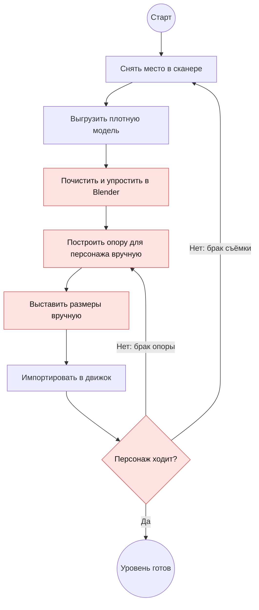
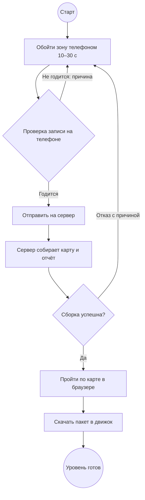
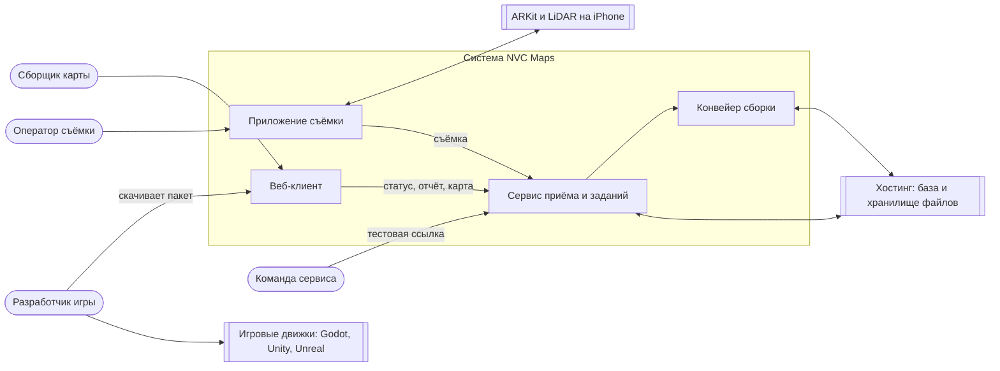
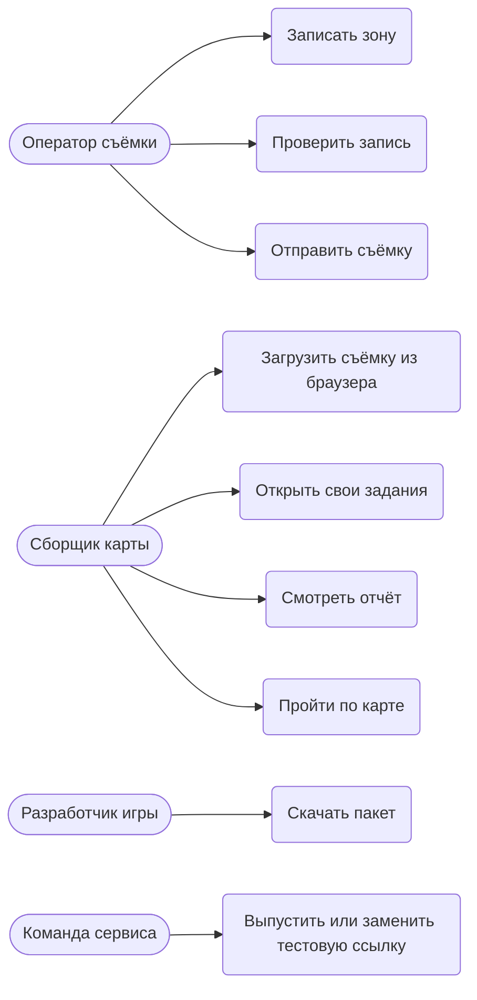
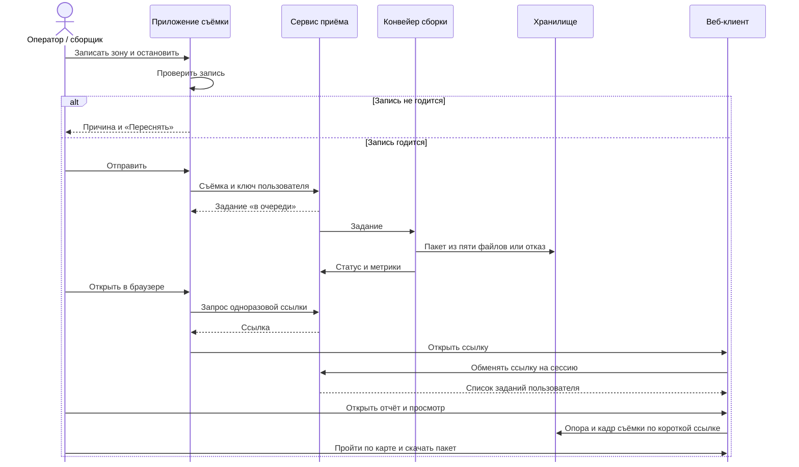
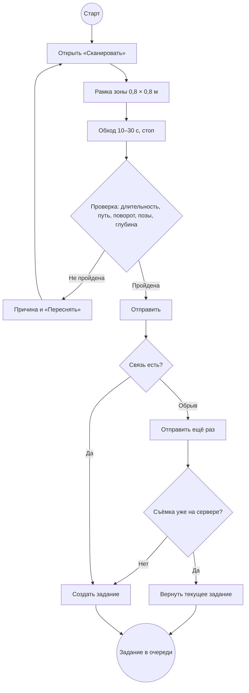

# Бизнес-анализ: система создания игровых 3D-карт по видеозаписи

**Продукт:** NVC Maps
**English:** A System for Creating 3D Game Maps from Video

Сайт с разделами и экранами: [kalashnikovkv.github.io/nvc-business-analysis](https://kalashnikovkv.github.io/nvc-business-analysis/)

Файл собирается скриптом `scripts/build-ba.py` из разделов `00`–`06`. Правки вносятся в разделы, не сюда.

---

## Введение

### Актуальность и проблема

**У кого проблема.** У тех, кто делает небольшие игры и прототипы без 3D-художника. Это инди-разработчики и участники гейм-джемов, level-дизайнеры небольших студий, авторы настольных макетов и диорам, преподаватели и студенты геймдев-курсов. В 2025 году в Steam вышло 18–20 тысяч игр[^1]. В Fortnite за 2024 год число авторов карт выросло с 24 до 70 тысяч[^2]. У Roblox к концу 2025 года в программе выплат было больше 35 тысяч авторов[^3].

**В чём проблема.** Человек хочет сделать уровень с реального места: угла стола, куска пола, макета. Телефон с датчиком глубины LiDAR снимает такое место в метрах[^4]. Но приложения-сканеры отдают модель для просмотра, а не уровень[^5]. По ней нельзя сразу пустить персонажа. Опору под ноги, упрощение модели, размеры и проверку проходимости делают вручную в 3D-редакторе и движке. Без навыков 3D-моделирования реальное место в прототип не попадает, а с навыками на него уходит много ручной работы. Плохая съёмка при этом выглядит как удачная: сканер выдаёт модель всегда, и брак становится виден только в движке.

**Почему сейчас.** LiDAR есть во всех iPhone Pro начиная с iPhone 12 Pro и в iPad Pro[^6]. Формат glTF 2.0 открывают браузер и популярные игровые движки[^7]. Число людей, которые делают игры и карты, растёт[^8]. Методы, на которых строится автоматическая сборка, — объёмное слияние глубины, построение поверхности и упрощение сетки — давно отработаны[^9]. Не хватает продукта, который соберёт их в путь «снял — прошёл по уровню».

### Цель и задачи

**Цель.** Сократить путь от съёмки реального участка до проходимого игрового уровня до одного обхода телефоном, без ручной доводки геометрии.

**Задачи.**

1. Описать, как уровень с реального места делают сейчас, и найти, где теряются время и данные (раздел 1.1).
2. Проанализировать источники и аналоги и определить, чего не хватает существующим решениям (разделы 1.2–1.3).
3. Сформулировать видение, бизнес-цели и измеримые KPI продукта (раздел 2.1).
4. Описать функциональные и нефункциональные требования: эпики, user stories с критериями приёмки, сценарии, NFR (разделы 2.5–2.7).
5. Определить правовые требования, риски и критерии оценки результата (разделы 2.8–2.10).

### Объект и предмет

**Объект** — процесс создания игрового уровня по реальному месту: от съёмки до первой проверки уровня в игровом движке.

**Предмет** — автоматизируемая часть этого процесса: проверка съёмки, сборка карты с отдельной опорой для персонажа, проверка проходимости в браузере и выдача пакета для движков.

### Методы

Требования собраны так:

- **Анализ документов.** Техническое задание и чертёж пайплайна проекта, спецификация glTF 2.0[^10], документация ARKit и RoomPlan[^11], регламент GDPR[^12], WCAG 2.1[^13].
- **Обзор литературы.** Научные работы по реконструкции поверхности, упрощению сеток и превращению видео в интерактивные сцены[^14].
- **Бенчмаркинг аналогов.** Сравнение девяти решений по открытым описаниям, документации и ценам[^15] (раздел 1.3).
- **Прото-персона.** Персона построена по результатам анализа документов и рынка. Интервью с пользователями не проводились; проверка персоны на реальных людях вынесена в риски (раздел 2.9).

Техники описаны по BABOK v3[^16]: анализ документов, бенчмаркинг и анализ рынка, моделирование процессов, user stories, приоритизация MoSCoW.

---

## 1. Аналитическая часть

### 1.1. Текущее состояние

#### Как задачу решают сейчас (AS-IS)

Готового пути «снял место — получил уровень» нет. Человек собирает его сам из нескольких инструментов. Процесс показан на диаграмме активности (рис. П.2.1).

Шаги, участники и потери текущего процесса приведены в табл. 1.1.

Табл. 1.1. Шаги текущего процесса и потери

| Шаг | Кто | Инструмент | Где теряются время и данные |
|-----|-----|------------|-----------------------------|
| 1. Снять место | Автор уровня | Сканер на телефоне: Polycam, Scaniverse, KIRI Engine | Приложение не говорит, годится ли съёмка для уровня. Оно оценивает только картинку |
| 2. Выгрузить модель | Автор уровня | Экспорт OBJ, FBX или GLB, часть форматов только в платном тарифе[^17] | Плотная модель на сотни тысяч треугольников, с мусором по краям |
| 3. Почистить и упростить | Автор уровня или 3D-художник | Blender | Ручная работа, нужны навыки. Размеры легко сбить при экспорте |
| 4. Сделать опору для персонажа | То же | Blender или движок | Отдельная упрощённая модель руками. Сплат не держит персонажа, опору всё равно строят отдельно[^18] |
| 5. Импортировать в движок и пройти | Разработчик | Godot, Unity, Unreal | Проходимость видна только здесь. Ошибку на шаге 1 или 4 находят в самом конце |
| 6. Переделать | Все | Все инструменты | Повторить тот же результат нельзя: каждый шаг ручной |

**Кто участвует.** Чаще всего один человек: инди-разработчик, level-дизайнер, автор макета или студент. В студии шаги 3–4 может делать 3D-художник, тогда добавляется передача файлов между людьми.

**Где теряется время.** Шаги 3–4: ручная чистка, упрощение и сборка опоры. Шаги 5–6: брак съёмки обнаруживают последним, и цикл повторяется с начала.

**Где теряются данные.** Размеры в метрах, которые измерил датчик, пропадают при экспорте и ручном масштабировании. Сведения о том, как снимали (путь камеры, глубина), в модель не попадают. Объяснить, почему уровень получился плохим, потом нельзя.

#### Условный пример

Персона Аня (раздел 2.2) участвует в гейм-джеме на 48 часов. Тема — «маленький мир», и она хочет сделать уровень из своего письменного стола с книгами и кружкой. Она снимает стол в Polycam и получает красивую модель на несколько сотен тысяч треугольников. Godot импортирует её, но персонаж проваливается: у модели нет отдельной опоры, а края стола рваные. Аня открывает Blender, вручную чистит края, упрощает модель и строит из кубов невидимую опору. При экспорте размеры сбиваются, и персонаж оказывается ростом с кружку. После второй попытки выясняется, что одна книга не попала в съёмку: Аня снимала слишком быстро. На уровень уходит полдня из 48 часов джема, и в итоге она заменяет стол кубами.

Этот пример показывает три потери: время на ручную доводку, поздно найденный брак съёмки и сбитые размеры. Именно их закрывает продукт.

#### Как будет (TO-BE)

Человек обходит участок телефоном 10–30 секунд. Приложение сразу проверяет запись и либо отправляет её на сервер, либо просит переснять с понятной причиной. Сервер сам собирает карту: видимую модель, отдельную лёгкую опору и отчёт, сохраняя размеры датчика. Человек проходит по карте в браузере и скачивает пакет в движок. Ручные шаги 3–4 и поздняя проверка 5 исчезают (рис. П.2.2).

### 1.2. Обзор источников

Использованы 24 источника, из них 9 научных. Источники разбиты на четыре группы: методы реконструкции, представление сцены, стандарты и правила, рынок и аналоги.

**Методы реконструкции.** Классический путь от глубины к поверхности описан в работах Курлесса и Левоя[^19] и в KinectFusion[^20]: карты глубины с известным положением камеры накапливаются в объёмной сетке, из которой поверхность извлекается алгоритмом marching cubes[^21]. Метод устойчив к шуму отдельного кадра, но полностью зависит от точности поз: ошибка траектории размазывает поверхность. Отсюда два решения продукта. Позы камеры обязательны, и без них сборка честно отказывает. Участок съёмки маленький, чтобы накопленная ошибка траектории не успевала вырасти. Упрощение по квадрикам[^22] позволяет уменьшить сетку до заданного числа треугольников с контролируемой потерей формы — это основа жёстких бюджетов визуала и опоры.

**Точность датчика.** Оценка LiDAR iPhone 12 Pro[^23] показывает, что датчик даёт сантиметровую точность на объектах в пределах нескольких метров, а на больших сценах ошибка растёт. Это подтверждает выбор небольшой зоны около 80×80 см и съёмки с небольшой высоты. Монокулярные модели глубины вроде Depth Anything V2[^24] восстанавливают форму по одному кадру, но не дают надёжных метров, поэтому годятся только как запасной выключенный режим.

**Представление сцены.** Gaussian splatting[^25] дал фотореалистичный просмотр сцен в реальном времени, и сканеры быстро его подхватили[^26]. Но у сплата нет поверхности, по которой может пройти персонаж: даже в инструкциях Polycam для Unreal коллизия берётся из отдельной модели[^27]. Video2Game[^28] — самая близкая к продукту работа: видео превращается в сцену с коллизиями, которая работает в браузере. Однако она требует обучения нейронного представления для каждой сцены и остаётся исследовательским конвейером, а не сервисом. Вывод для продукта: красивая картинка и пригодная для игры опора — разные задачи, и продукт решает вторую.

**Стандарты и правила.** glTF 2.0[^29] задаёт метры как единицу и ось Y вверх и читается браузером и движками — это делает пакет переносимым без конвертации. GDPR[^30] требует правового основания, минимизации данных и права на удаление: съёмка помещения может случайно захватить людей. WCAG 2.1[^31] задаёт измеримый уровень доступности веб-клиента. Техники выявления требований взяты из BABOK v3[^32].

Что из каждой группы источников следует для требований главы 2, показано в табл. 1.2.

Табл. 1.2. Выводы из источников для требований

| Источники | Что из них следует | Где в требованиях |
|-----------|--------------------|-------------------|
| Слияние глубины[^33], Open3D[^34] | Карты глубины с известными позами сливаются в поверхность; без поз результат не собрать. Готовые реализации открыты (MIT) | Позы обязательны, иначе отказ: US-3.2; лицензии: 2.8 |
| Marching cubes[^35], упрощение по квадрикам[^36] | Поверхность строится автоматически, число треугольников можно жёстко ограничить | Бюджет карты: KPI-4, US-3.3 |
| LiDAR iPhone 12 Pro[^37], устройства[^38] | Сантиметровая точность на небольшом участке; глубина есть только на Pro-устройствах Apple | Зона 80×80 см, платформа iOS: 2.3 |
| Gaussian splatting[^39], сплаты в движках[^40] | У сплата нет физической поверхности; коллизию добавляют отдельной моделью | Отдельная опора: US-5.1; сплаты вне релиза |
| Depth Anything V2[^41] | Глубина по одному кадру даёт форму, но не надёжные метры | Сборка без LiDAR — выключенный режим: 2.3 |
| Video2Game[^42] | Видео превращается в интерактивную сцену с коллизией, но ценой обучения сцены; это исследование, а не продукт | Ходьба в браузере: US-4.1; без обучения нейросети на каждую сцену |
| glTF 2.0[^43], RoomPlan[^44] | Открытый формат с метрами и осью Y вверх; RoomPlan даёт план, а не поверхность | Пакет GLB и манифест: US-5.2 |
| GDPR[^45], WCAG 2.1[^46], BABOK[^47] | Правовое основание, минимизация, удаление; доступность AA; техники выявления требований | 2.8, NFR-9; методы во введении |
| Рынок[^48], аналоги[^49] | Авторов игр много и больше с каждым годом; сканеры отдают модель, а не уровень | Сегменты: 2.2; аналоги: 1.3 |

**Вывод.** Технологии сборки поверхности и упрощения зрелые[^50]. Датчик телефона точен на небольшом участке[^51]. Новизна продукта не в алгоритмах, а в том, чтобы связать их в проверяемый путь от съёмки до проходимого уровня с честным отказом.

### 1.3. Анализ аналогов

Рассмотрены девять решений. Коммерческие: Polycam[^52] (подписка около 27 $ в месяц), Scaniverse[^53] (Niantic Spatial), KIRI Engine[^54] (50–80 $ в год), RealityScan[^55] (Epic Games, выгрузка через Sketchfab в Unreal), Luma[^56] (сплаты, плагин Unreal), World Labs Marble[^57] (генерирует 3D-мир из текста, фото или видео и отдаёт опору в GLB), а также API Apple RoomPlan[^58], который строит план комнаты из стен и мебели. Открытые: научный Video2Game[^59] с открытым кодом и ручной путь на COLMAP, Open3D[^60] и Blender.

**Polycam** — самый популярный сканер с LiDAR и фотограмметрией. Сильная сторона — качество модели и широкий выбор форматов. Для уровня из него нужна ручная доводка: опоры нет, модель плотная, часть форматов только в платном тарифе.

**Scaniverse** — бесплатный сканер Niantic Spatial с мешами и сплатами. В 2026 году добавил пакет для симуляторов роботов, где модель строится из сплата[^61]. Это шаг к «пригодной для симуляции» сцене, но не к лёгкому игровому уровню.

**KIRI Engine** ориентирован на художников: ретопология, PBR-материалы, экспорт в Blender и Unreal. Результат — ассет, а не проходимый участок.

**RealityScan** от Epic Games ведёт модель в экосистему Unreal через Sketchfab[^62]. Он снимает объекты, а не участки, и привязан к одному движку.

**Luma** делает фотореалистичные сплаты и плагин для Unreal[^63]. По сплату нельзя ходить, а размеры не привязаны к метрам.

**World Labs Marble** ближе всего по выходу: отдаёт отдельную опору в GLB[^64]. Но мир генерируется моделью, а не измеряется, опора тяжёлая (100–200 тыс. треугольников), проверки ходьбой и отказа нет.

**Apple RoomPlan** строит план помещения из стен, дверей и мебели[^65]. Это схема комнаты, а не поверхность стола или макета, и только в помещении.

**Video2Game** доказывает, что путь «видео → проходимая сцена» возможен[^66], но требует обучения на каждую сцену и не является продуктом.

**Ручной путь** на COLMAP, Open3D[^67] и Blender даёт полный контроль, но требует навыков и времени и не повторяется одной командой.

#### Сравнение по критериям

Результаты сравнения сведены в табл. 1.3.

Табл. 1.3. Сравнение аналогов по критериям

| Критерий | Polycam, Scaniverse, KIRI | RealityScan | Luma | Marble | Video2Game | NVC Maps |
|----------|---------------------------|-------------|------|--------|------------|----------|
| Съёмка реального места телефоном | Да | Да | Да | Частично: фото или видео на вход | Видео, не телефон | Да |
| Настоящие размеры в метрах | Да, с LiDAR | Частично | Нет | Нет | Нет | Да, с LiDAR |
| Отдельная лёгкая опора для персонажа | Нет | Нет | Нет | Да, 100–200 тыс. треугольников[^68] | Да | Да, ≤ 25% от визуала |
| Бюджет треугольников для игры | Вручную | Вручную | — | Нет | Нет | Да, ≤ 50 000 |
| Проверка ходьбой до движка | Нет | Нет | Только просмотр | Частично | Да | Да, в браузере |
| Отказ на плохой съёмке с причиной | Нет | Нет | Нет | Нет | Нет | Да |
| Повторяемость сборки | Не заявлена | Не заявлена | Не заявлена | Не заявлена | Не заявлена | Да, ±15% |
| Открытый формат для любых движков | Много форматов | Через Sketchfab | Плагин Unreal | GLB | Свой демо-движок | GLB и манифест |
| Красота картинки | Сильная сторона | Сильная сторона | Сильная сторона | Сильная сторона | Средняя | Слабая сторона релиза |

#### Чего не хватает

1. **Опоры для персонажа в метрах.** Сканеры отдают только видимую модель. Marble отдаёт опору, но мир сгенерирован моделью и его размеры не настоящие.
2. **Проверки проходимости до движка.** Кроме исследовательского Video2Game, никто не даёт пройти по результату до импорта.
3. **Честного отказа.** Ни одно решение не говорит «эта съёмка не годится для уровня» и почему.
4. **Повторяемости и лёгкого пакета.** Результат нельзя пересобрать тем же способом и уложить в игровой бюджет без ручной работы.

**Где аналоги сильнее.** Качество картинки, текстуры, размер сцены (комната, улица), поддержка Android. Продукт сознательно уступает им здесь и выигрывает в пригодности результата для игры.

### 1.4. Выводы по главе

Выявленные проблемы и то, что должно уметь новое решение, сведены в табл. 1.4.

Табл. 1.4. Проблемы и их связь с эпиками и KPI

| № | Проблема | Что должно уметь новое решение | Эпик | KPI |
|---|----------|-------------------------------|------|-----|
| П1 | Плохая съёмка выглядит как удачная, брак находят в движке | Проверить запись на телефоне и отказать с причиной | E1, E3 | KPI-3 |
| П2 | Опору для персонажа и упрощение делают руками | Собрать видимую модель и лёгкую опору автоматически | E3, E5 | KPI-1, KPI-4 |
| П3 | Проходимость видна только в движке | Дать пройти по карте в браузере | E4 | KPI-1, KPI-2 |
| П4 | Размеры датчика теряются по дороге | Сохранить метры и записать единицы и оси в манифест | E5 | KPI-1 |
| П5 | Путь от съёмки до уровня долгий и не повторяется | Принять съёмку, собрать карту на сервере, показать статус | E2, E3 | KPI-2 |
| П6 | Без телефона с LiDAR продукт не проверить | Открыть эталонные задания по тестовой ссылке | E6 | KPI-1, KPI-3 |

---

## 2. Требования к системе

### 2.1. Видение и цели

#### Видение

NVC Maps превращает короткое видео реального места в игровой уровень. Человек обходит небольшой участок с iPhone, а сервис сам собирает карту, по которой персонаж может ходить, проверяет её в браузере и отдаёт файлом для любого движка. Плохая съёмка получает честный отказ с причиной, а не кривую карту.

#### Бизнес-цели

Бизнес-цели перечислены в табл. 2.1.

Табл. 2.1. Бизнес-цели

| ID | Цель |
|----|------|
| BG-1 | Убрать ручную доводку геометрии из пути от съёмки до проходимого уровня |
| BG-2 | Сократить время от съёмки до первой проверки уровня |
| BG-3 | Не выдавать непригодную съёмку за готовую карту |
| BG-4 | Отдавать карту, которая сразу укладывается в игровой бюджет |

#### KPI

Достижение целей измеряется четырьмя KPI (табл. 2.2).

Табл. 2.2. KPI: базовые и целевые значения

| ID | Показатель | Базовое значение (сейчас) | Целевое значение | Как измерить |
|----|-----------|---------------------------|------------------|--------------|
| KPI-1 | Доля пригодных эталонных съёмок, по которым получен проходимый уровень без ручной доводки | 0%: сканеры не отдают опору для персонажа (раздел 1.3) | 100% на эталонных съёмках S1, S2 | Прогон эталонов, проверка ходьбой: персонаж стоит ≥ 5 с и проходит карту от края до края |
| KPI-2 | Время от отправки съёмки до первой проверки ходьбой | 2–4 ч по ручному пути AS-IS (оценка автора, шаги 2–5 раздела 1.1) | ≤ 15 мин | Время между отправкой и открытием карты в браузере на эталонах |
| KPI-3 | Доля непригодных съёмок, получивших отказ с причиной | 0%: сканеры выдают модель при любой съёмке | 100% на эталонных съёмках N1, N2 | Прогон эталонов, текст причины в отчёте |
| KPI-4 | Вес карты | Плотный скан: сотни тысяч треугольников; опора Marble — 100–200 тыс.[^69] | Визуал ≤ 50 000 треугольников; опора ≤ 25% от визуала и ≥ 100 граней | Метрики в отчёте сборки |

### 2.2. Стейкхолдеры и пользователи

#### Стейкхолдеры

Стейкхолдеры, их интерес и влияние приведены в табл. 2.3.

Табл. 2.3. Стейкхолдеры: интерес и влияние

| Стейкхолдер | Интерес | Интерес (H/M/L) | Влияние (H/M/L) |
|-------------|---------|-----------------|-----------------|
| Пользователи: инди-разработчики, level-дизайнеры, авторы макетов, преподаватели и студенты | Быстро получить проходимый уровень с реального места | H | H |
| Владелец продукта и команда | Продукт снимает боль пользователей и работает без ручного вмешательства; команда ведёт сервис и тестовую ссылку | H | H |
| Apple: iOS, ARKit, LiDAR, App Store | Приложение по правилам App Store, понятный запрос доступа к камере | L | H |
| Игровые движки и стандарт glTF: Godot, Unity, Unreal, Khronos Group | Корректные файлы в открытом формате | L | H |
| Надзор за персональными данными (GDPR) | Лица и чужие помещения не попадают в данные без основания | L | H |
| Хостинг-провайдер | Ресурсы в пределах тарифа и лимитов | L | M |
| Авторы открытых библиотек и моделей: Open3D, PyTorch, Depth Anything | Соблюдение лицензий | L | M |
| Конкуренты: Polycam, Scaniverse, KIRI, RealityScan, Luma, World Labs | Задают ожидания пользователей от сканера | M | M |
| Сообщества: itch.io и гейм-джемы, курсы геймдева, Fortnite Creative, Roblox | Инструменты, которые ускоряют создание игр; канал к пользователям | M | L |
| Игрок на готовой карте | Не провалиться сквозь пол | H | L |
| Владелец снимаемого места | Знать о съёмке и иметь право отказать | H | L |
| Человек, случайно попавший в кадр | Не оказаться в чужих материалах | H | L |

С группами H/H согласуются границы релиза и критерии успеха. Правила групп L/H соблюдаются как ограничения: App Store, glTF, GDPR. Интересы групп H/L защищаются правилами продукта: проверкой ходьбой, правилами съёмки, запретом лиц крупным планом.

#### Пользователи системы (акторы)

- **Оператор съёмки** — снимает участок, проходит проверку записи, отправляет съёмку.
- **Сборщик карты** — следит за заданиями, читает отчёт, проходит по карте в браузере.
- **Разработчик игры** — скачивает пакет и забирает его в движок.
- **Команда сервиса** — выпускает и меняет тестовую ссылку на эталонные задания.

Обычно первые три роли выполняет один человек. Диаграмма вариантов использования — рис. П.2.4.

#### Персона

Персона построена по результатам анализа документов и рынка (введение, «Методы»). Её проверка на интервью вынесена в риски (R6).

**Аня, 24 года, инди-разработчица.** Делает небольшие игры на Godot в свободное время, участвует в гейм-джемах на 48–72 часа. 3D-модели берёт из бесплатных библиотек, в Blender работает с трудом. Есть iPhone 15 Pro.

- **Цель:** за пару часов джема получить уровень с настоящей фактурой, например со своего письменного стола.
- **Боль:** сканер даёт красивую модель, но персонаж по ней не ходит; на сборку опоры уходит вечер, которого на джеме нет.
- **Как продукт помогает:** обход стола за 30 секунд, проверка ходьбой в браузере, GLB сразу в Godot.

### 2.3. Границы проекта

#### Входит в релиз

- Съёмка на iPhone или iPad с LiDAR: зона около 80×80 см, обход, проверка записи, отправка на сервер.
- Сборка карты в размерах датчика: видимая модель, лёгкая опора, манифест, границы, отчёт.
- Отказ с причиной на непригодной съёмке вместо произвольной геометрии.
- Приём съёмки, очередь заданий, статус, хранение пакета.
- Браузер: загрузка съёмки, список своих заданий, отчёт, ходьба по опоре рядом с кадром съёмки, скачивание пакета.
- Вход в браузер одноразовой ссылкой с телефона; тестовая ссылка на четыре эталонных задания.
- Открытое описание обмена: что принимается и что отдаётся.

#### Не входит в релиз

- Полноценная игра и обязательная демонстрация в Unreal.
- Масштабирование карты под конкретного персонажа.
- Текстуры, второй уровень детализации, сплаты.
- Обучение собственной модели глубины; сборка без LiDAR влияет на релиз только как выключенный режим.
- Android как платформа релиза.
- Панель администрирования, учётные записи, роли, просмотр чужих карт.

#### Допущения и ограничения

Допущения и ограничения проекта приведены в табл. 2.4.

Табл. 2.4. Допущения и ограничения

| Тип | Описание | Следствие |
|-----|----------|-----------|
| Ресурсы | Продукт делает один разработчик | При нехватке времени первыми выпадают истории Should и Could (раздел 2.5) |
| Сроки | Срок первого релиза фиксирован календарём проекта | Объём ограничен Must-историями; всё остальное — после релиза |
| Устройства | Для съёмки нужен iPhone Pro или iPad Pro с LiDAR[^70]; симулятор и браузер глубину не дают | Без устройства продукт проверяют по четырём эталонным съёмкам и тестовой ссылке |
| Доступ к данным | Используются только собственные съёмки автора и четыре эталона: две пригодные, две непригодные. Чужих датасетов нет | Согласие организаций не требуется (заявления); проверка ограничена эталонами |
| API и платформа | Глубина и позы — только через ARKit на устройстве[^71]; формат карты — glTF 2.0[^72] | Платформа релиза — iOS; пакет в GLB |
| Вычисления | Размер участка ограничен объёмом вычислений сервера: по умолчанию 80×80 см | Пороги качества заданы для этого размера |

### 2.4. Концепция решения

Решение состоит из четырёх частей (рис. П.2.3):

1. **Приложение съёмки на iPhone.** Пишет видео, позы камеры, служебные данные и глубину LiDAR, проверяет запись и отправляет её на сервер. Адрес сервера и ключ пользователя хранятся в приложении.
2. **Сервис приёма.** Принимает съёмку с телефона или из браузера, ставит задание в очередь, хранит задания, метрики и ссылки на файлы. Повторная отправка той же съёмки возвращает текущее задание.
3. **Конвейер сборки.** Отдельный серверный процесс берёт задание из очереди, собирает пакет из пяти файлов и кладёт его в хранилище. При непригодной съёмке пишет отказ с причиной.
4. **Веб-клиент.** Показывает задания этого пользователя, отчёт и ходьбу по опоре рядом с кадром съёмки. Вход — одноразовой ссылкой с телефона или многоразовой тестовой ссылкой на эталонные задания.

Внешние системы: ARKit на устройстве, хостинг с базой и хранилищем файлов, игровые движки, которые открывают пакет.

#### Альтернативы

Две альтернативы сравниваются в табл. 2.5.

Табл. 2.5. Сравнение альтернатив концепции

| Критерий | А. Сборка на телефоне | Б. Сборка на сервере и проверка в браузере (выбрано) |
|----------|-----------------------|-----------------------------------------------------|
| Вычисления | Ограничены телефоном: слияние глубины и упрощение на всём участке нагревают устройство и долго идут | Сервер собирает без ограничений устройства; размер участка настраивается |
| Повторяемость | Результат зависит от модели телефона и версии приложения | Один сборщик и одни настройки для всех съёмок |
| Проверка без телефона | Невозможна: без LiDAR-устройства продукт не проверить | Эталонные задания по тестовой ссылке |
| Проверка ходьбой | Только на телефоне, мелко и неудобно | В браузере на большом экране рядом с кадром съёмки |
| Приватность | Данные не покидают телефон | Данные хранятся на сервере: нужны правовое основание и удаление (2.8) |
| Стоимость | Нет затрат на сервер | Затраты на хостинг |

**Обоснование выбора.** Вариант Б выигрывает в повторяемости, проверке без устройства и удобстве проверки ходьбой. Это прямо поддерживает KPI-1–KPI-3. Минусы варианта — приватность и стоимость — закрыты требованиями 2.8 и рисками R4, R5.

### 2.5. Функциональные требования

#### Эпики

Эпики и их связь с бизнес-целями и KPI приведены в табл. 2.6.

Табл. 2.6. Эпики и их связь с целями

| Эпик | Название | Бизнес-цель | KPI |
|------|----------|-------------|-----|
| E1 | Съёмка и проверка записи | BG-3 | KPI-3 |
| E2 | Отправка и задания | BG-2 | KPI-2 |
| E3 | Сборка, отчёт и качество | BG-1, BG-3, BG-4 | KPI-1, KPI-3, KPI-4 |
| E4 | Проверка ходьбой в браузере | BG-1, BG-2 | KPI-1, KPI-2 |
| E5 | Пакет для движка | BG-1, BG-4 | KPI-1, KPI-4 |
| E6 | Ведение сервиса | BG-2 | KPI-1, KPI-3 |

Критерии приёмки записаны в формате «Дано / Когда / Тогда» (Given / When / Then). Полный бэклог одной таблицей — в приложении 1.

Макеты ключевых историй US-1.2, US-2.4, US-3.1 и US-4.1 — на рис. 2.1; все экраны — на сайте проекта.

#### E1. Съёмка и проверка записи

Истории эпика и критерии приёмки — в табл. 2.7.

Табл. 2.7. Истории эпика E1. Съёмка и проверка записи

| ID | История | Критерии приёмки | MoSCoW |
|----|---------|------------------|--------|
| US-1.1 | **Запись зоны.** **Как** оператор съёмки, **я хочу** записать участок на телефоне с LiDAR, **чтобы** получить съёмку с глубиной в метрах. | 1) **Дано** телефон с LiDAR и открытая запись, **когда** оператор начинает запись, **тогда** на полу фиксируется зона 0,8 × 0,8 м. 2) **Дано** запись остановлена, **когда** съёмка сохраняется, **тогда** в ней есть видео, позы камеры, служебные данные и кадры глубины. | Must |
| US-1.2 | **Проверка записи до отправки.** **Как** оператор съёмки, **я хочу** сразу узнать, годится ли запись, **чтобы** не отправлять брак и переснять на месте. | 1) **Дано** запись 10–30 с с путём камеры ≥ 0,28 м и поворотом ≥ 90°, **когда** проверка завершена, **тогда** показано «Готово» и кнопка «Отправить». 2) **Дано** запись короче 10 с, длиннее 30 с, без поз или без глубины, **когда** проверка завершена, **тогда** показана причина одной фразой и кнопка «Переснять». 3) **Дано** проверка не пройдена, **когда** оператор пытается отправить запись, **тогда** отправка недоступна. | Must |
| US-1.3 | **Подсказка обхода.** **Как** оператор съёмки, **я хочу** видеть во время записи, сколько ещё обойти, **чтобы** снять участок с первого раза. | 1) **Дано** идёт запись, **когда** путь камеры меньше 0,28 м или поворот меньше 90°, **тогда** на экране видна подсказка, что обойти ещё. | Should |

#### E2. Отправка и задания

Истории эпика и критерии приёмки — в табл. 2.8.

Табл. 2.8. Истории эпика E2. Отправка и задания

| ID | История | Критерии приёмки | MoSCoW |
|----|---------|------------------|--------|
| US-2.1 | **Отправка с телефона.** **Как** оператор съёмки, **я хочу** отправить запись на сервер одной кнопкой, **чтобы** сборка началась без ручной команды. | 1) **Дано** проверка пройдена, **когда** оператор нажимает «Отправить», **тогда** создаётся задание со статусом «в очереди». 2) **Дано** отправка не удалась из-за сети, **когда** приходит ошибка, **тогда** причина показана текстом и отправку можно повторить. | Must |
| US-2.2 | **Загрузка из браузера.** **Как** сборщик карты, **я хочу** загрузить сохранённую съёмку формой в браузере, **чтобы** собрать карту без телефона. | 1) **Дано** открыта форма загрузки, **когда** выбран файл без видео, поз или служебных данных, **тогда** до отправки показано, чего не хватает. 2) **Дано** состав съёмки полный, **когда** сборщик отправляет форму, **тогда** создаётся задание и открывается список заданий. | Must |
| US-2.3 | **Повторная отправка без второй сборки.** **Как** сборщик карты, **я хочу**, чтобы повтор той же съёмки после обрыва связи не запускал вторую сборку, **чтобы** в списке не было дублей и задание не висело без статуса. | 1) **Дано** задание по съёмке уже создано, **когда** та же съёмка отправлена ещё раз, **тогда** возвращается текущее задание, вторая сборка не стартует. 2) **Дано** первое задание завершилось отказом, **когда** съёмка отправлена ещё раз, **тогда** виден этот отказ с причиной. | Must |
| US-2.4 | **Мои задания в браузере.** **Как** сборщик карты, **я хочу** одной кнопкой с телефона открыть в браузере все свои задания, **чтобы** смотреть отчёты и карты на большом экране. | 1) **Дано** у пользователя есть задания, **когда** он нажимает «Открыть в браузере», **тогда** браузер открывает список всех его заданий с датой и статусом. 2) **Дано** одноразовая ссылка уже открыта или истекла, **когда** её открывают снова, **тогда** список не открывается, а телефон выдаёт новую ссылку. 3) **Дано** другой браузер без сессии, **когда** открывается адрес чужого задания, **тогда** карта и отчёт не показываются. | Must |
| US-2.5 | **Фильтр по статусу.** **Как** сборщик карты, **я хочу** отфильтровать задания по статусу, **чтобы** быстро найти готовые карты и отказы. | 1) **Дано** открыт список заданий, **когда** выбран фильтр «готово», **тогда** видны только готовые задания. | Should |
| US-2.6 | **Удаление съёмки с телефона.** **Как** оператор съёмки, **я хочу** удалить ненужную съёмку из «Моих карт», **чтобы** освободить память телефона. | 1) **Дано** карточка съёмки в «Моих картах», **когда** оператор подтверждает удаление, **тогда** файлы съёмки удаляются с телефона. | Could |

#### E3. Сборка, отчёт и качество

Истории эпика и критерии приёмки — в табл. 2.9.

Табл. 2.9. Истории эпика E3. Сборка, отчёт и качество

| ID | История | Критерии приёмки | MoSCoW |
|----|---------|------------------|--------|
| US-3.1 | **Отчёт о сборке.** **Как** сборщик карты, **я хочу** видеть в отчёте статус, способ построения и метрики, **чтобы** решать по цифрам, а не на глаз. | 1) **Дано** сборка завершена, **когда** сборщик открывает отчёт, **тогда** видны статус, способ построения, число треугольников визуала и опоры, размеры файлов. 2) **Дано** сборка успешна, **когда** открыт отчёт, **тогда** способ построения — слияние глубины LiDAR, а не заглушка. | Must |
| US-3.2 | **Отказ с причиной.** **Как** сборщик карты, **я хочу** получить отказ с понятной причиной на непригодной съёмке, **чтобы** не принять брак за карту. | 1) **Дано** съёмка без корректных поз или с неудачной реконструкцией, **когда** сборка завершается, **тогда** статус — «отказ» и в отчёте текст причины. 2) **Дано** статус «отказ», **когда** сборщик открывает задание, **тогда** геометрия-заглушка не выдаётся и скачать пакет нельзя. | Must |
| US-3.3 | **Карта в игровом бюджете.** **Как** разработчик игры, **я хочу** получать карту в пределах бюджета, **чтобы** не упрощать её вручную. | 1) **Дано** сборка успешна, **когда** пакет записан, **тогда** визуал ≤ 50 000 треугольников и ≤ 25 МБ. 2) **Дано** сборка успешна, **когда** пакет записан, **тогда** опора ≤ 25% граней визуала, ≥ 100 граней и ≤ 8 МБ. | Must |
| US-3.4 | **Сравнение повторной сборки.** **Как** сборщик карты, **я хочу** сравнить повторную сборку той же съёмки с первой, **чтобы** убедиться, что результат воспроизводится. | 1) **Дано** две сборки одной съёмки, **когда** сборщик сравнивает отчёты, **тогда** способ построения совпадает, а число треугольников различается не больше чем на 15%. | Should |

#### E4. Проверка ходьбой в браузере

Истории эпика и критерии приёмки — в табл. 2.10.

Табл. 2.10. Истории эпика E4. Проверка ходьбой в браузере

| ID | История | Критерии приёмки | MoSCoW |
|----|---------|------------------|--------|
| US-4.1 | **Ходьба по карте.** **Как** сборщик карты, **я хочу** пройти по готовой карте персонажем в браузере, **чтобы** проверить проходимость без игрового движка. | 1) **Дано** сборка успешна, **когда** сборщик открывает просмотр, **тогда** персонаж стоит на опоре не меньше 5 с и не проваливается. 2) **Дано** открыт просмотр, **когда** сборщик ведёт персонажа от края до края, **тогда** персонаж проходит карту целиком. | Must |
| US-4.2 | **Кадр съёмки рядом с картой.** **Как** сборщик карты, **я хочу** видеть рядом с моделью кадр съёмки, **чтобы** сравнить карту с реальным местом. | 1) **Дано** открыт просмотр, **когда** карта загружена, **тогда** рядом виден кадр съёмки с той же камеры. | Must |
| US-4.3 | **Рост персонажа при показе.** **Как** сборщик карты, **я хочу** менять рост персонажа в просмотре, **чтобы** примерить карту под разные игры. | 1) **Дано** открыт просмотр, **когда** сборщик меняет рост персонажа, **тогда** персонаж меняется, а геометрия карты и файлы пакета — нет. | Should |

#### E5. Пакет для движка

Истории эпика и критерии приёмки — в табл. 2.11.

Табл. 2.11. Истории эпика E5. Пакет для движка

| ID | История | Критерии приёмки | MoSCoW |
|----|---------|------------------|--------|
| US-5.1 | **Скачивание пакета.** **Как** разработчик игры, **я хочу** скачать пакет из пяти файлов, **чтобы** открыть карту в своём движке. | 1) **Дано** сборка успешна, **когда** разработчик нажимает «Скачать», **тогда** он получает `map.glb`, `collision.glb`, `manifest.json`, `bounds.json`, `report.json`. 2) **Дано** пакет скачан, **когда** оба GLB открываются в просмотрщике glTF, **тогда** они открываются без ошибок. | Must |
| US-5.2 | **Настоящие размеры и описание пакета.** **Как** разработчик игры, **я хочу** получать карту в метрах датчика с описанием осей, **чтобы** самому выставить масштаб персонажа. | 1) **Дано** пакет скачан, **когда** разработчик читает манифест, **тогда** там указаны метры, ось Y вверх и факт центрирования. 2) **Дано** пакет собран, **когда** сравниваются размеры карты и съёмки, **тогда** масштаб геометрии не менялся. | Must |
| US-5.3 | **Инструкция для Godot.** **Как** разработчик игры, **я хочу** короткую инструкцию, как открыть пакет в Godot, **чтобы** не разбираться с импортом самому. | 1) **Дано** открыт отчёт, **когда** разработчик переходит по ссылке «Как открыть в Godot», **тогда** видны шаги импорта визуала и опоры. | Should |

#### E6. Ведение сервиса

Истории эпика и критерии приёмки — в табл. 2.12.

Табл. 2.12. Истории эпика E6. Ведение сервиса

| ID | История | Критерии приёмки | MoSCoW |
|----|---------|------------------|--------|
| US-6.1 | **Тестовая ссылка на эталоны.** **Как** команда сервиса, **я хочу** выпустить многоразовую ссылку на четыре эталонных задания, **чтобы** продукт можно было проверить без телефона с LiDAR. | 1) **Дано** выпущена тестовая ссылка, **когда** её открывают в любом браузере, **тогда** видны только четыре эталонных задания с отчётами и ходьбой. 2) **Дано** открыта тестовая ссылка, **когда** смотрят список, **тогда** личные задания пользователей не видны. | Must |
| US-6.2 | **Замена тестовой ссылки.** **Как** команда сервиса, **я хочу** заменить тестовую ссылку, **чтобы** закрыть доступ по старой. | 1) **Дано** ссылка заменена, **когда** открывают старую, **тогда** задания не открываются. | Must |

#### Приоритеты

Сводка приоритетов приведена в табл. 2.13.

Табл. 2.13. Приоритеты MoSCoW

| Приоритет | Истории | Почему |
|-----------|---------|--------|
| Must | US-1.1, US-1.2, US-2.1–US-2.4, US-3.1–US-3.3, US-4.1, US-4.2, US-5.1, US-5.2, US-6.1, US-6.2 | Без них не достигаются KPI-1–KPI-4 |
| Should | US-1.3, US-2.5, US-3.4, US-4.3, US-5.3 | Улучшают удобство и проверку; первыми выпадают при нехватке времени |
| Could | US-2.6 | Мелкое удобство на телефоне |
| Won't | Полноценная игра, обязательный Unreal, своя модель глубины, Android, панель администрирования и учётные записи, масштабирование карты | Вне границ релиза (2.3) |

#### Трассировка «цель → эпик → история»

Связь целей, эпиков и историй показана в табл. 2.14.

Табл. 2.14. Трассировка «цель → эпик → история»

| Цель | KPI | Эпик | Истории |
|------|-----|------|---------|
| BG-1 Без ручной доводки | KPI-1 | E3, E4, E5 | US-3.1, US-3.3, US-4.1, US-4.2, US-5.1, US-5.2 |
| BG-2 Быстрее до проверки | KPI-2 | E2, E4, E6 | US-2.1–US-2.5, US-4.1, US-6.1, US-6.2 |
| BG-3 Честный отказ | KPI-3 | E1, E3 | US-1.1–US-1.3, US-3.2 |
| BG-4 Игровой бюджет | KPI-4 | E3, E5 | US-3.3, US-3.4, US-5.2 |

### 2.6. Сценарии использования

#### UC-1. Снять и отправить участок

- **Актор:** оператор съёмки.
- **Предусловие:** iPhone или iPad с LiDAR, приложение установлено, доступ к камере разрешён.
- **Результат:** задание на сборку создано и стоит в очереди.

**Основной поток**

1. Оператор открывает «Сканировать» и наводит телефон на пол.
2. Система показывает рамку зоны 0,8 × 0,8 м.
3. Оператор начинает запись и обходит зону 10–30 с.
4. Оператор останавливает запись.
5. Система проверяет длительность, путь, поворот, позы и глубину и показывает «Готово».
6. Оператор нажимает «Отправить».
7. Система передаёт съёмку на сервер; сервер создаёт задание и возвращает его статус «в очереди».

**Альтернативный поток A1. Проверка не пройдена.** На шаге 5 система показывает причину одной фразой и «Переснять». Оператор возвращается к шагу 1. Отправка этой записи недоступна.

**Альтернативный поток A2. Обрыв связи при отправке.** На шаге 7 связь обрывается. Оператор нажимает «Отправить» ещё раз. Сервер узнаёт съёмку и возвращает уже созданное задание; вторая сборка не стартует.

Диаграмма активности сценария — рис. П.2.6.

#### UC-2. Проверить карту в браузере

- **Актор:** сборщик карты.
- **Предусловие:** у пользователя есть хотя бы одно отправленное задание; приложение на телефоне хранит его ключ.
- **Результат:** сборщик прошёл по карте и скачал пакет.

**Основной поток**

1. Сборщик нажимает на телефоне «Открыть в браузере».
2. Система выдаёт одноразовую ссылку и открывает браузер.
3. Система по ссылке создаёт сессию и показывает список заданий пользователя.
4. Сборщик открывает готовое задание; система показывает отчёт.
5. Сборщик открывает просмотр; система загружает опору и кадр съёмки.
6. Сборщик проходит персонажем от края до края.
7. Сборщик нажимает «Скачать»; система отдаёт пакет из пяти файлов по короткой ссылке.

**Альтернативный поток A1. Ссылка истекла.** На шаге 3 ссылка уже открыта или истекла. Система показывает пустой вход. Сборщик возвращается к шагу 1, телефон выдаёт новую ссылку.

**Альтернативный поток A2. Сборка завершилась отказом.** На шаге 4 статус — «отказ». Система показывает причину; просмотр и скачивание недоступны. Сборщик переходит к UC-1, чтобы переснять участок.

Системная диаграмма последовательности для UC-1 и UC-2 — рис. П.2.5.

### 2.7. Нефункциональные требования

Нефункциональные требования с измеримыми показателями приведены в табл. 2.15.

Табл. 2.15. Нефункциональные требования

| ID | Категория | Требование | Показатель и значение | KPI, истории |
|----|-----------|-----------|-----------------------|--------------|
| NFR-1 | Производительность | Сборка эталонной съёмки | ≤ 10 мин от постановки в очередь до статуса «готово» или «отказ» | KPI-2; US-2.1, US-3.1 |
| NFR-2 | Производительность | Открытие просмотра карты | ≤ 10 с до управления персонажем на канале 50 Мбит/с | KPI-2; US-4.1 |
| NFR-3 | Производительность | Размер файлов пакета | `map.glb` ≤ 25 МБ, `collision.glb` ≤ 8 МБ | KPI-4; US-3.3 |
| NFR-4 | Надёжность | Повторяемость сборки | Тот же способ построения, расхождение по треугольникам ≤ 15% | KPI-1; US-3.4 |
| NFR-5 | Безопасность | Доступ к заданиям | Список, отчёт, просмотр и файлы отдаются только сессии владельца: 0 успешных открытий чужого задания в проверке | US-2.4, US-6.1 |
| NFR-6 | Безопасность | Срок жизни ссылок | Одноразовая ссылка действует 1 раз и ≤ 10 мин; ссылка на файл — ≤ 15 мин | US-2.4, US-5.1 |
| NFR-7 | Безопасность | Секреты | 0 паролей и ключей в образе сервиса и репозитории; секреты задаёт хостинг | — |
| NFR-8 | Доступность сервиса | Время работы | ≥ 99% за календарный месяц по внешнему мониторингу | KPI-2 |
| NFR-9 | Удобство | Веб-клиент | Соответствие WCAG 2.1 AA[^73]: контраст текста ≥ 4,5 : 1, все формы проходятся с клавиатуры | US-2.2, US-2.4 |
| NFR-10 | Удобство | Телефон | Зоны нажатия ≥ 44 pt; причина отказа — одна фраза ≤ 120 символов | US-1.2 |

### 2.8. Правовые и этические требования

#### Персональные данные

Какие данные могут быть персональными и на каком основании они обрабатываются, показано в табл. 2.16.

Табл. 2.16. Персональные данные и основания обработки

| Данные | Почему могут быть персональными | Основание по GDPR[^74] | Требование |
|--------|-------------------------------|------------------------|------------|
| Ключ пользователя на телефоне | Псевдонимный идентификатор человека | Ст. 6(1)(b): исполнение услуги по запросу пользователя | Ключ не связывается с именем, почтой или телефоном |
| Видео и глубина участка | В кадр может случайно попасть человек или чужое помещение | Ст. 6(1)(b) для автора съёмки; ст. 6(1)(f), законный интерес, для случайных людей в кадре | Снимается только пол, стол или макет; запись с лицом крупным планом не публикуется; звук для сборки не нужен и не хранится |
| IP-адреса в журналах сервера | Сетевой идентификатор | Ст. 6(1)(f): безопасность сервиса | Журналы хранятся ≤ 30 дней |

- **Минимизация и сроки.** Съёмки и пакеты хранятся ≤ 90 дней с последнего открытия, затем удаляются.
- **Право на удаление (ст. 17).** Пользователь может запросить удаление своих заданий по почте, указанной на сайте. Запрос исполняется ≤ 30 дней по номеру задания. Отдельной панели для этого нет (2.3).
- **Прозрачность (ст. 13).** В приложении и на сайте есть короткое уведомление: какие данные собираются, зачем, сколько хранятся и как удалить.
- **Владелец места.** Пользователь подтверждает, что снимает своё место или место с разрешения владельца.

#### Согласие участников интервью

Интервью и опросы в работе не проводились (введение, «Методы»). Согласие участников не требуется. Если интервью будут проведены для проверки персон (R6), участники подписывают согласие на запись и обработку ответов.

#### Лицензии

Open3D[^75] и trimesh — MIT, PyTorch — BSD-3-Clause: используются с сохранением уведомлений об авторском праве. Из моделей Depth Anything V2[^76] используется только Small под Apache-2.0; более крупные модели с некоммерческой лицензией не используются. glTF 2.0[^77] — открытый стандарт без отчислений. Эталонные съёмки сделаны автором, права третьих лиц не затрагиваются.

#### Стандарты

- **WCAG 2.1 AA**[^78] для веб-клиента (NFR-9).
- **glTF 2.0**[^79] для пакета карты (US-5.1, US-5.2).
- **App Store Review Guidelines**: понятное описание, зачем приложению камера.

### 2.9. Риски

Риски проекта оценены в табл. 2.17.

Табл. 2.17. Риски проекта

| ID | Риск | Вероятность | Влияние | Снижение | Зависимость |
|----|------|-------------|---------|----------|-------------|
| R1 | Карта получается неузнаваемой или с дырами | M | H | Небольшая зона, обязательные позы и глубина, отказ вместо произвольной геометрии | Качество LiDAR[^80], алгоритмы слияния[^81] |
| R2 | Опора не держит персонажа | M | H | Проверка ходьбой до выдачи пакета; бюджет опоры не меньше 100 граней | US-4.1, US-3.3 |
| R3 | Нет телефона с LiDAR у проверяющего или пользователя | H | M | Четыре эталонные съёмки и тестовая ссылка | US-6.1; доступ к устройствам (2.3) |
| R4 | Сборка требует больше ресурсов, чем даёт хостинг | M | M | Настраиваемый размер зоны, ограничение числа кадров, очередь | Хостинг-провайдер |
| R5 | Персональные данные попадают в кадр или хранятся дольше нужного | L | H | Правила съёмки, срок хранения 90 дней, удаление по запросу | Требования 2.8, GDPR[^82] |
| R6 | Персона и боли не совпадают с реальными пользователями: интервью не проводились | M | H | Проверить персону на 5 интервью с инди-разработчиками до следующего релиза; следить за KPI | Методы (введение) |
| R7 | Изменятся правила App Store или API ARKit | L | H | Следить за обновлениями Apple; формат съёмки описан открыто, и бандл можно загрузить из браузера | Apple |

Вероятность и влияние: H — высокое, M — среднее, L — низкое.

### 2.10. Выводы по главе

**Что зафиксировано в требованиях.** Видение и четыре бизнес-цели с KPI, базовыми и целевыми значениями. Стейкхолдеры и акторы, персона. Границы релиза, допущения и ограничения. Концепция решения с контекстной диаграммой и обоснованием выбора. Шесть эпиков и 21 user story с приоритетами MoSCoW и критериями приёмки в формате «Дано / Когда / Тогда». Два сценария использования с альтернативными потоками и диаграммой последовательности. Десять измеримых NFR, правовые требования, семь рисков.

**Как проверяется результат.** Критерии оценки совпадают с KPI раздела 2.1 и проверяются на четырёх эталонных съёмках по тестовой ссылке:

- **KPI-1:** эталоны S1 и S2 дают проходимый уровень без ручной доводки — ходьба ≥ 5 с и от края до края (US-4.1).
- **KPI-2:** от отправки до проверки ходьбой ≤ 15 мин (NFR-1, NFR-2).
- **KPI-3:** эталоны N1 и N2 получают отказ с текстом причины (US-3.2).
- **KPI-4:** визуал ≤ 50 000 треугольников, опора ≤ 25% и ≥ 100 граней, файлы в пределах NFR-3 (US-3.3).

Релиз не принимается, если успех получен подстановкой заглушки, карта доводится вручную после сборки, геометрия масштабируется, персонаж проваливается сквозь опору или непригодная съёмка завершилась успехом.

---

## Список источников и литературы

1. Apple Inc. “Models with a LiDAR Scanner.” Apple Support. Accessed October 19, 2026. <https://support.apple.com/en-gb/guide/ipad/aside/ipad8a95fdc0/ipados>.
2. Apple Inc. “RoomPlan.” Apple Developer. Accessed October 19, 2026. <https://developer.apple.com/augmented-reality/roomplan>.
3. Curless, Brian, and Marc Levoy. “A Volumetric Method for Building Complex Models from Range Images.” In *Proceedings of the 23rd Annual Conference on Computer Graphics and Interactive Techniques (SIGGRAPH)*, 303–12. 1996.
4. Epic Games. “Epic Games Releases Free RealityScan iOS App for 3D Scanning.” December 2022. Accessed October 19, 2026. <https://www.epicgames.com/site/en-US/news/epic-games-releases-free-realityscan-ios-app-for-3d-scanning>.
5. Epic Games. “Fortnite Ecosystem 2024 Year in Review: Celebrating Creators and Looking Ahead.” January 22, 2025. Accessed October 19, 2026. <https://www.fortnite.com/news/fortnite-ecosystem-2024-year-in-review-celebrating-creators-and-looking-ahead>.
6. European Parliament and Council of the European Union. “Regulation (EU) 2016/679 on the Protection of Natural Persons with Regard to the Processing of Personal Data (General Data Protection Regulation).” *Official Journal of the European Union* L 119 (May 4, 2016): 1–88.
7. Garland, Michael, and Paul S. Heckbert. “Surface Simplification Using Quadric Error Metrics.” In *Proceedings of the 24th Annual Conference on Computer Graphics and Interactive Techniques (SIGGRAPH)*, 209–16. 1997.
8. International Institute of Business Analysis. *A Guide to the Business Analysis Body of Knowledge (BABOK Guide)*. Version 3. Toronto: IIBA, 2015.
9. Kerbl, Bernhard, Georgios Kopanas, Thomas Leimkühler, and George Drettakis. “3D Gaussian Splatting for Real-Time Radiance Field Rendering.” *ACM Transactions on Graphics* 42, no. 4 (2023): art. 139.
10. Khronos Group. “glTF 2.0 Specification.” 2021. Accessed October 19, 2026. <https://registry.khronos.org/glTF/specs/2.0/glTF-2.0.html>.
11. KIRI Innovations. “KIRI Engine Pricing.” Accessed October 19, 2026. <https://www.kiriengine.app/Pricing>.
12. Lorensen, William E., and Harvey E. Cline. “Marching Cubes: A High Resolution 3D Surface Construction Algorithm.” *ACM SIGGRAPH Computer Graphics* 21, no. 4 (1987): 163–69.
13. Luetzenburg, Gregor, Aart Kroon, and Anders A. Bjørk. “Evaluation of the Apple iPhone 12 Pro LiDAR for an Application in Geosciences.” *Scientific Reports* 11 (2021): art. 22221.
14. Luma AI. “Luma Unreal Engine Plugin.” Documentation. Accessed October 19, 2026. <https://lumaai.notion.site/Luma-Unreal-Engine-Plugin-0-4-8005919d93444c008982346185e933a1>.
15. MP1st. “Over 18,000 Games Released on Steam in 2025, but Half Have Fewer Than 10 Reviews.” 2026. Accessed October 19, 2026. <https://mp1st.com/news/18k-games-released-steam-2025-half-have-10-reviews>.
16. Newcombe, Richard A., Shahram Izadi, Otmar Hilliges, David Molyneaux, David Kim, Andrew J. Davison, Pushmeet Kohli, Jamie Shotton, Steve Hodges, and Andrew Fitzgibbon. “KinectFusion: Real-Time Dense Surface Mapping and Tracking.” In *Proceedings of the 10th IEEE International Symposium on Mixed and Augmented Reality (ISMAR)*, 127–36. 2011.
17. Niantic Spatial. “Scaniverse – 3D Scanner.” App Store. Accessed October 19, 2026. <https://apps.apple.com/us/app/-/id1541433223>.
18. Polycam. “Export Gaussian Splats from Polycam to Unreal Engine.” Help Center. Accessed October 19, 2026. <https://learn.poly.cam/hc/en-us/articles/42506758152084>.
19. Roblox Corporation. “Form 10-K for the Fiscal Year Ended December 31, 2025.” U.S. Securities and Exchange Commission, 2026. Accessed October 19, 2026. <https://www.sec.gov/Archives/edgar/data/1315098/000131509826000024/rblx-20251231.htm>.
20. W3C. “Web Content Accessibility Guidelines (WCAG) 2.1.” W3C Recommendation, June 5, 2018. Accessed October 19, 2026. <https://www.w3.org/TR/WCAG21/>.
21. World Labs. “Marble: Export Mesh.” Documentation. Accessed October 19, 2026. <https://docs.worldlabs.ai/marble/export/mesh>.
22. Xia, Hongchi, Zhi-Hao Lin, Wei-Chiu Ma, and Shenlong Wang. “Video2Game: Real-Time Interactive Realistic and Browser-Compatible Environment from a Single Video.” In *Proceedings of the IEEE/CVF Conference on Computer Vision and Pattern Recognition (CVPR)*, 4578–88. 2024.
23. Yang, Lihe, Bingyi Kang, Zilong Huang, Zhen Zhao, Xiaogang Xu, Jiashi Feng, and Hengshuang Zhao. “Depth Anything V2.” In *Advances in Neural Information Processing Systems (NeurIPS)*. 2024.
24. Zhou, Qian-Yi, Jaesik Park, and Vladlen Koltun. “Open3D: A Modern Library for 3D Data Processing.” Preprint, arXiv:1801.09847, 2018.

---

## Приложение 1. Бэклог

Полная таблица эпиков и историй приведена в табл. П.1.1.

Табл. П.1.1. Бэклог: эпики и истории

| ID | Эпик | История | Критерии приёмки | MoSCoW |
|----|------|---------|------------------|--------|
| US-1.1 | E1 | **Запись зоны.** **Как** оператор съёмки, **я хочу** записать участок на телефоне с LiDAR, **чтобы** получить съёмку с глубиной в метрах. | 1) **Дано** телефон с LiDAR и открытая запись, **когда** оператор начинает запись, **тогда** на полу фиксируется зона 0,8 × 0,8 м. 2) **Дано** запись остановлена, **когда** съёмка сохраняется, **тогда** в ней есть видео, позы камеры, служебные данные и кадры глубины. | Must |
| US-1.2 | E1 | **Проверка записи до отправки.** **Как** оператор съёмки, **я хочу** сразу узнать, годится ли запись, **чтобы** не отправлять брак и переснять на месте. | 1) **Дано** запись 10–30 с с путём камеры ≥ 0,28 м и поворотом ≥ 90°, **когда** проверка завершена, **тогда** показано «Готово» и кнопка «Отправить». 2) **Дано** запись короче 10 с, длиннее 30 с, без поз или без глубины, **когда** проверка завершена, **тогда** показана причина одной фразой и кнопка «Переснять». 3) **Дано** проверка не пройдена, **когда** оператор пытается отправить запись, **тогда** отправка недоступна. | Must |
| US-1.3 | E1 | **Подсказка обхода.** **Как** оператор съёмки, **я хочу** видеть во время записи, сколько ещё обойти, **чтобы** снять участок с первого раза. | 1) **Дано** идёт запись, **когда** путь камеры меньше 0,28 м или поворот меньше 90°, **тогда** на экране видна подсказка, что обойти ещё. | Should |
| US-2.1 | E2 | **Отправка с телефона.** **Как** оператор съёмки, **я хочу** отправить запись на сервер одной кнопкой, **чтобы** сборка началась без ручной команды. | 1) **Дано** проверка пройдена, **когда** оператор нажимает «Отправить», **тогда** создаётся задание со статусом «в очереди». 2) **Дано** отправка не удалась из-за сети, **когда** приходит ошибка, **тогда** причина показана текстом и отправку можно повторить. | Must |
| US-2.2 | E2 | **Загрузка из браузера.** **Как** сборщик карты, **я хочу** загрузить сохранённую съёмку формой в браузере, **чтобы** собрать карту без телефона. | 1) **Дано** открыта форма загрузки, **когда** выбран файл без видео, поз или служебных данных, **тогда** до отправки показано, чего не хватает. 2) **Дано** состав съёмки полный, **когда** сборщик отправляет форму, **тогда** создаётся задание и открывается список заданий. | Must |
| US-2.3 | E2 | **Повторная отправка без второй сборки.** **Как** сборщик карты, **я хочу**, чтобы повтор той же съёмки после обрыва связи не запускал вторую сборку, **чтобы** в списке не было дублей и задание не висело без статуса. | 1) **Дано** задание по съёмке уже создано, **когда** та же съёмка отправлена ещё раз, **тогда** возвращается текущее задание, вторая сборка не стартует. 2) **Дано** первое задание завершилось отказом, **когда** съёмка отправлена ещё раз, **тогда** виден этот отказ с причиной. | Must |
| US-2.4 | E2 | **Мои задания в браузере.** **Как** сборщик карты, **я хочу** одной кнопкой с телефона открыть в браузере все свои задания, **чтобы** смотреть отчёты и карты на большом экране. | 1) **Дано** у пользователя есть задания, **когда** он нажимает «Открыть в браузере», **тогда** браузер открывает список всех его заданий с датой и статусом. 2) **Дано** одноразовая ссылка уже открыта или истекла, **когда** её открывают снова, **тогда** список не открывается, а телефон выдаёт новую ссылку. 3) **Дано** другой браузер без сессии, **когда** открывается адрес чужого задания, **тогда** карта и отчёт не показываются. | Must |
| US-2.5 | E2 | **Фильтр по статусу.** **Как** сборщик карты, **я хочу** отфильтровать задания по статусу, **чтобы** быстро найти готовые карты и отказы. | 1) **Дано** открыт список заданий, **когда** выбран фильтр «готово», **тогда** видны только готовые задания. | Should |
| US-2.6 | E2 | **Удаление съёмки с телефона.** **Как** оператор съёмки, **я хочу** удалить ненужную съёмку из «Моих карт», **чтобы** освободить память телефона. | 1) **Дано** карточка съёмки в «Моих картах», **когда** оператор подтверждает удаление, **тогда** файлы съёмки удаляются с телефона. | Could |
| US-3.1 | E3 | **Отчёт о сборке.** **Как** сборщик карты, **я хочу** видеть в отчёте статус, способ построения и метрики, **чтобы** решать по цифрам, а не на глаз. | 1) **Дано** сборка завершена, **когда** сборщик открывает отчёт, **тогда** видны статус, способ построения, число треугольников визуала и опоры, размеры файлов. 2) **Дано** сборка успешна, **когда** открыт отчёт, **тогда** способ построения — слияние глубины LiDAR, а не заглушка. | Must |
| US-3.2 | E3 | **Отказ с причиной.** **Как** сборщик карты, **я хочу** получить отказ с понятной причиной на непригодной съёмке, **чтобы** не принять брак за карту. | 1) **Дано** съёмка без корректных поз или с неудачной реконструкцией, **когда** сборка завершается, **тогда** статус — «отказ» и в отчёте текст причины. 2) **Дано** статус «отказ», **когда** сборщик открывает задание, **тогда** геометрия-заглушка не выдаётся и скачать пакет нельзя. | Must |
| US-3.3 | E3 | **Карта в игровом бюджете.** **Как** разработчик игры, **я хочу** получать карту в пределах бюджета, **чтобы** не упрощать её вручную. | 1) **Дано** сборка успешна, **когда** пакет записан, **тогда** визуал ≤ 50 000 треугольников и ≤ 25 МБ. 2) **Дано** сборка успешна, **когда** пакет записан, **тогда** опора ≤ 25% граней визуала, ≥ 100 граней и ≤ 8 МБ. | Must |
| US-3.4 | E3 | **Сравнение повторной сборки.** **Как** сборщик карты, **я хочу** сравнить повторную сборку той же съёмки с первой, **чтобы** убедиться, что результат воспроизводится. | 1) **Дано** две сборки одной съёмки, **когда** сборщик сравнивает отчёты, **тогда** способ построения совпадает, а число треугольников различается не больше чем на 15%. | Should |
| US-4.1 | E4 | **Ходьба по карте.** **Как** сборщик карты, **я хочу** пройти по готовой карте персонажем в браузере, **чтобы** проверить проходимость без игрового движка. | 1) **Дано** сборка успешна, **когда** сборщик открывает просмотр, **тогда** персонаж стоит на опоре не меньше 5 с и не проваливается. 2) **Дано** открыт просмотр, **когда** сборщик ведёт персонажа от края до края, **тогда** персонаж проходит карту целиком. | Must |
| US-4.2 | E4 | **Кадр съёмки рядом с картой.** **Как** сборщик карты, **я хочу** видеть рядом с моделью кадр съёмки, **чтобы** сравнить карту с реальным местом. | 1) **Дано** открыт просмотр, **когда** карта загружена, **тогда** рядом виден кадр съёмки с той же камеры. | Must |
| US-4.3 | E4 | **Рост персонажа при показе.** **Как** сборщик карты, **я хочу** менять рост персонажа в просмотре, **чтобы** примерить карту под разные игры. | 1) **Дано** открыт просмотр, **когда** сборщик меняет рост персонажа, **тогда** персонаж меняется, а геометрия карты и файлы пакета — нет. | Should |
| US-5.1 | E5 | **Скачивание пакета.** **Как** разработчик игры, **я хочу** скачать пакет из пяти файлов, **чтобы** открыть карту в своём движке. | 1) **Дано** сборка успешна, **когда** разработчик нажимает «Скачать», **тогда** он получает `map.glb`, `collision.glb`, `manifest.json`, `bounds.json`, `report.json`. 2) **Дано** пакет скачан, **когда** оба GLB открываются в просмотрщике glTF, **тогда** они открываются без ошибок. | Must |
| US-5.2 | E5 | **Настоящие размеры и описание пакета.** **Как** разработчик игры, **я хочу** получать карту в метрах датчика с описанием осей, **чтобы** самому выставить масштаб персонажа. | 1) **Дано** пакет скачан, **когда** разработчик читает манифест, **тогда** там указаны метры, ось Y вверх и факт центрирования. 2) **Дано** пакет собран, **когда** сравниваются размеры карты и съёмки, **тогда** масштаб геометрии не менялся. | Must |
| US-5.3 | E5 | **Инструкция для Godot.** **Как** разработчик игры, **я хочу** короткую инструкцию, как открыть пакет в Godot, **чтобы** не разбираться с импортом самому. | 1) **Дано** открыт отчёт, **когда** разработчик переходит по ссылке «Как открыть в Godot», **тогда** видны шаги импорта визуала и опоры. | Should |
| US-6.1 | E6 | **Тестовая ссылка на эталоны.** **Как** команда сервиса, **я хочу** выпустить многоразовую ссылку на четыре эталонных задания, **чтобы** продукт можно было проверить без телефона с LiDAR. | 1) **Дано** выпущена тестовая ссылка, **когда** её открывают в любом браузере, **тогда** видны только четыре эталонных задания с отчётами и ходьбой. 2) **Дано** открыта тестовая ссылка, **когда** смотрят список, **тогда** личные задания пользователей не видны. | Must |
| US-6.2 | E6 | **Замена тестовой ссылки.** **Как** команда сервиса, **я хочу** заменить тестовую ссылку, **чтобы** закрыть доступ по старой. | 1) **Дано** ссылка заменена, **когда** открывают старую, **тогда** задания не открываются. | Must |

---

## Приложение 2. Диаграммы

Рис. П.2.1. Процесс AS-IS: уровень с реального места сегодня

UML-диаграмма активности. Ручные шаги и поздняя проверка отмечены красным.

Рис. П.2.2. Процесс TO-BE: уровень с NVC Maps

Рис. П.2.3. Контекстная диаграмма

Рис. П.2.4. Диаграмма вариантов использования

Рис. П.2.5. Системная диаграмма последовательности: UC-1 и UC-2

Рис. П.2.6. Диаграмма активности UC-1 с альтернативными потоками

---

## Заявления

### Использование искусственного интеллекта

Использование инструментов ИИ

| Инструмент | Для чего использован | Как |
|------------|----------------------|-----|
| Claude (Anthropic), Claude Code | Поиск и сравнение аналогов, сбор данных о рынке | Веб-поиск по запросам автора; найденные цифры и описания проверены по ссылкам из списка литературы |
| Claude (Anthropic), Claude Code | Структурирование документа по требованиям к блоку бизнес-анализа | Автор задавал структуру разделов и решения по продукту; модель предлагала формулировки, автор их проверял и правил |
| Claude (Anthropic), Claude Code | Черновики диаграмм, таблиц и критериев приёмки | Модель готовила черновики по требованиям проекта; автор проверял соответствие продукту |
| Claude (Anthropic), Claude Code | Сборка документа | Скрипты, которые собирают сайт, PDF и DOCX из исходных файлов |

Решения о продукте, границах релиза, приоритетах и выборе концепции принимал автор. Все факты из внешних источников сопровождаются ссылками.

---

[^1]: MP1st, “Over 18,000 Games Released on Steam in 2025, but Half Have Fewer Than 10 Reviews,” 2026, accessed October 19, 2026, <https://mp1st.com/news/18k-games-released-steam-2025-half-have-10-reviews>.
[^2]: Epic Games, “Fortnite Ecosystem 2024 Year in Review: Celebrating Creators and Looking Ahead,” January 22, 2025, accessed October 19, 2026, <https://www.fortnite.com/news/fortnite-ecosystem-2024-year-in-review-celebrating-creators-and-looking-ahead>.
[^3]: Roblox Corporation, “Form 10-K for the Fiscal Year Ended December 31, 2025” (U.S. Securities and Exchange Commission, 2026), accessed October 19, 2026, <https://www.sec.gov/Archives/edgar/data/1315098/000131509826000024/rblx-20251231.htm>.
[^4]: Gregor Luetzenburg, Aart Kroon, and Anders A. Bjørk, “Evaluation of the Apple iPhone 12 Pro LiDAR for an Application in Geosciences,” *Scientific Reports* 11 (2021): art. 22221; Apple Inc., “Models with a LiDAR Scanner,” Apple Support, accessed October 19, 2026, <https://support.apple.com/en-gb/guide/ipad/aside/ipad8a95fdc0/ipados>.
[^5]: World Labs, “Marble: Export Mesh,” documentation, accessed October 19, 2026, <https://docs.worldlabs.ai/marble/export/mesh>; Niantic Spatial, “Scaniverse – 3D Scanner,” App Store, accessed October 19, 2026, <https://apps.apple.com/us/app/-/id1541433223>; Polycam, “Export Gaussian Splats from Polycam to Unreal Engine,” Help Center, accessed October 19, 2026, <https://learn.poly.cam/hc/en-us/articles/42506758152084>; KIRI Innovations, “KIRI Engine Pricing,” accessed October 19, 2026, <https://www.kiriengine.app/Pricing>.
[^6]: Apple, “Models with a LiDAR Scanner.”
[^7]: Khronos Group, “glTF 2.0 Specification,” 2021, accessed October 19, 2026, <https://registry.khronos.org/glTF/specs/2.0/glTF-2.0.html>.
[^8]: Epic Games, “Fortnite Ecosystem 2024 Year in Review”; Roblox Corporation, “Form 10-K 2025”; MP1st, “Over 18,000 Games Released on Steam in 2025.”
[^9]: Richard A. Newcombe et al., “KinectFusion: Real-Time Dense Surface Mapping and Tracking,” in *Proceedings of the 10th IEEE International Symposium on Mixed and Augmented Reality (ISMAR)* (2011), 127–36; Brian Curless and Marc Levoy, “A Volumetric Method for Building Complex Models from Range Images,” in *Proceedings of the 23rd Annual Conference on Computer Graphics and Interactive Techniques (SIGGRAPH)* (1996), 303–12; William E. Lorensen and Harvey E. Cline, “Marching Cubes: A High Resolution 3D Surface Construction Algorithm,” *ACM SIGGRAPH Computer Graphics* 21, no. 4 (1987): 163–69; Michael Garland and Paul S. Heckbert, “Surface Simplification Using Quadric Error Metrics,” in *Proceedings of the 24th Annual Conference on Computer Graphics and Interactive Techniques (SIGGRAPH)* (1997), 209–16.
[^10]: Khronos Group, “glTF 2.0 Specification.”
[^11]: Apple Inc., “RoomPlan,” Apple Developer, accessed October 19, 2026, <https://developer.apple.com/augmented-reality/roomplan>.
[^12]: European Parliament and Council of the European Union, “Regulation (EU) 2016/679 (General Data Protection Regulation),” *Official Journal of the European Union* L 119 (May 4, 2016): 1–88.
[^13]: W3C, “Web Content Accessibility Guidelines (WCAG) 2.1,” W3C Recommendation, June 5, 2018, accessed October 19, 2026, <https://www.w3.org/TR/WCAG21/>.
[^14]: Hongchi Xia et al., “Video2Game: Real-Time Interactive Realistic and Browser-Compatible Environment from a Single Video,” in *Proceedings of the IEEE/CVF Conference on Computer Vision and Pattern Recognition (CVPR)* (2024), 4578–88; Newcombe et al., “KinectFusion”; Curless and Levoy, “Volumetric Method”; Lorensen and Cline, “Marching Cubes”; Garland and Heckbert, “Surface Simplification”; Bernhard Kerbl et al., “3D Gaussian Splatting for Real-Time Radiance Field Rendering,” *ACM Transactions on Graphics* 42, no. 4 (2023): art. 139; Luetzenburg, Kroon, and Bjørk, “Evaluation of the Apple iPhone 12 Pro LiDAR”; Lihe Yang et al., “Depth Anything V2,” in *Advances in Neural Information Processing Systems (NeurIPS)* (2024); Qian-Yi Zhou, Jaesik Park, and Vladlen Koltun, “Open3D: A Modern Library for 3D Data Processing,” preprint, arXiv:1801.09847, 2018.
[^15]: Xia et al., “Video2Game”; World Labs, “Marble: Export Mesh”; Niantic Spatial, “Scaniverse”; Polycam, “Export Gaussian Splats”; KIRI Innovations, “KIRI Engine Pricing”; Apple, “RoomPlan.”
[^16]: International Institute of Business Analysis, *A Guide to the Business Analysis Body of Knowledge (BABOK Guide)*, version 3 (Toronto: IIBA, 2015).
[^17]: KIRI Innovations, “KIRI Engine Pricing.”
[^18]: Polycam, “Export Gaussian Splats.”
[^19]: Curless and Levoy, “Volumetric Method.”
[^20]: Newcombe et al., “KinectFusion.”
[^21]: Lorensen and Cline, “Marching Cubes.”
[^22]: Garland and Heckbert, “Surface Simplification.”
[^23]: Luetzenburg, Kroon, and Bjørk, “Evaluation of the Apple iPhone 12 Pro LiDAR.”
[^24]: Yang et al., “Depth Anything V2.”
[^25]: Kerbl et al., “3D Gaussian Splatting.”
[^26]: Niantic Spatial, “Scaniverse”; Polycam, “Export Gaussian Splats”; Luma AI, “Luma Unreal Engine Plugin,” documentation, accessed October 19, 2026, <https://lumaai.notion.site/Luma-Unreal-Engine-Plugin-0-4-8005919d93444c008982346185e933a1>.
[^27]: Polycam, “Export Gaussian Splats.”
[^28]: Xia et al., “Video2Game.”
[^29]: Khronos Group, “glTF 2.0 Specification.”
[^30]: GDPR.
[^31]: W3C, “WCAG 2.1.”
[^32]: IIBA, *BABOK Guide*.
[^33]: Newcombe et al., “KinectFusion”; Curless and Levoy, “Volumetric Method.”
[^34]: Zhou, Park, and Koltun, “Open3D.”
[^35]: Lorensen and Cline, “Marching Cubes.”
[^36]: Garland and Heckbert, “Surface Simplification.”
[^37]: Luetzenburg, Kroon, and Bjørk, “Evaluation of the Apple iPhone 12 Pro LiDAR.”
[^38]: Apple, “Models with a LiDAR Scanner.”
[^39]: Kerbl et al., “3D Gaussian Splatting.”
[^40]: Polycam, “Export Gaussian Splats”; Luma AI, “Luma Unreal Engine Plugin.”
[^41]: Yang et al., “Depth Anything V2.”
[^42]: Xia et al., “Video2Game.”
[^43]: Khronos Group, “glTF 2.0 Specification.”
[^44]: Apple, “RoomPlan.”
[^45]: GDPR.
[^46]: W3C, “WCAG 2.1.”
[^47]: IIBA, *BABOK Guide*.
[^48]: Epic Games, “Fortnite Ecosystem 2024 Year in Review”; Roblox Corporation, “Form 10-K 2025”; MP1st, “Over 18,000 Games Released on Steam in 2025.”
[^49]: World Labs, “Marble: Export Mesh”; Niantic Spatial, “Scaniverse”; Polycam, “Export Gaussian Splats”; KIRI Innovations, “KIRI Engine Pricing”; Epic Games, “Epic Games Releases Free RealityScan iOS App for 3D Scanning,” December 2022, accessed October 19, 2026, <https://www.epicgames.com/site/en-US/news/epic-games-releases-free-realityscan-ios-app-for-3d-scanning>; Luma AI, “Luma Unreal Engine Plugin.”
[^50]: Newcombe et al., “KinectFusion”; Curless and Levoy, “Volumetric Method”; Lorensen and Cline, “Marching Cubes”; Garland and Heckbert, “Surface Simplification”; Zhou, Park, and Koltun, “Open3D.”
[^51]: Luetzenburg, Kroon, and Bjørk, “Evaluation of the Apple iPhone 12 Pro LiDAR.”
[^52]: Polycam, “Export Gaussian Splats.”
[^53]: Niantic Spatial, “Scaniverse.”
[^54]: KIRI Innovations, “KIRI Engine Pricing.”
[^55]: Epic Games, “RealityScan iOS App.”
[^56]: Luma AI, “Luma Unreal Engine Plugin.”
[^57]: World Labs, “Marble: Export Mesh.”
[^58]: Apple, “RoomPlan.”
[^59]: Xia et al., “Video2Game.”
[^60]: Zhou, Park, and Koltun, “Open3D.”
[^61]: Niantic Spatial, “Scaniverse.”
[^62]: Epic Games, “RealityScan iOS App.”
[^63]: Luma AI, “Luma Unreal Engine Plugin.”
[^64]: World Labs, “Marble: Export Mesh.”
[^65]: Apple, “RoomPlan.”
[^66]: Xia et al., “Video2Game.”
[^67]: Zhou, Park, and Koltun, “Open3D.”
[^68]: World Labs, “Marble: Export Mesh.”
[^69]: World Labs, “Marble: Export Mesh.”
[^70]: Apple, “Models with a LiDAR Scanner.”
[^71]: Apple, “RoomPlan.”
[^72]: Khronos Group, “glTF 2.0 Specification.”
[^73]: W3C, “WCAG 2.1.”
[^74]: GDPR.
[^75]: Zhou, Park, and Koltun, “Open3D.”
[^76]: Yang et al., “Depth Anything V2.”
[^77]: Khronos Group, “glTF 2.0 Specification.”
[^78]: W3C, “WCAG 2.1.”
[^79]: Khronos Group, “glTF 2.0 Specification.”
[^80]: Luetzenburg, Kroon, and Bjørk, “Evaluation of the Apple iPhone 12 Pro LiDAR.”
[^81]: Newcombe et al., “KinectFusion”; Curless and Levoy, “Volumetric Method.”
[^82]: GDPR.
