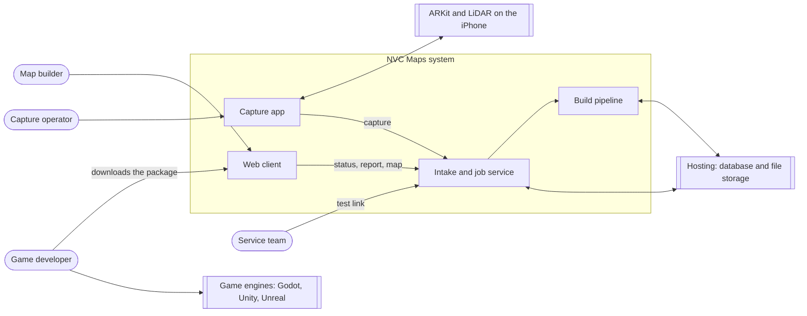
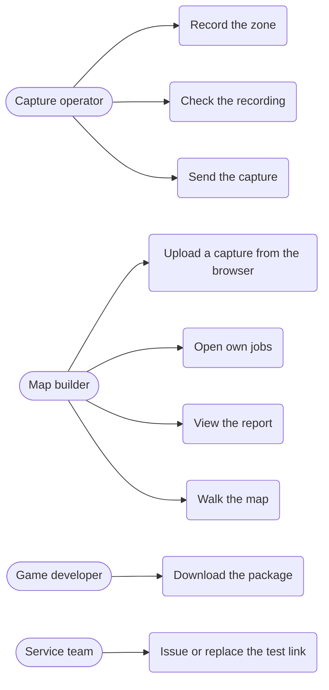
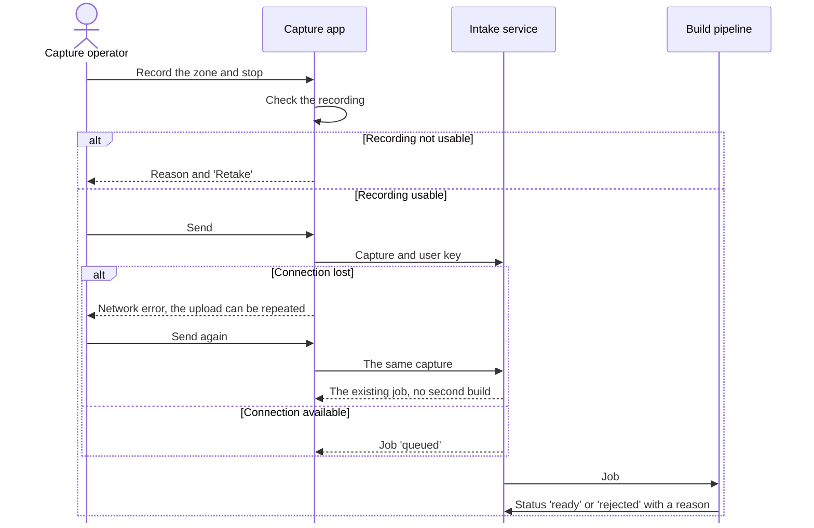
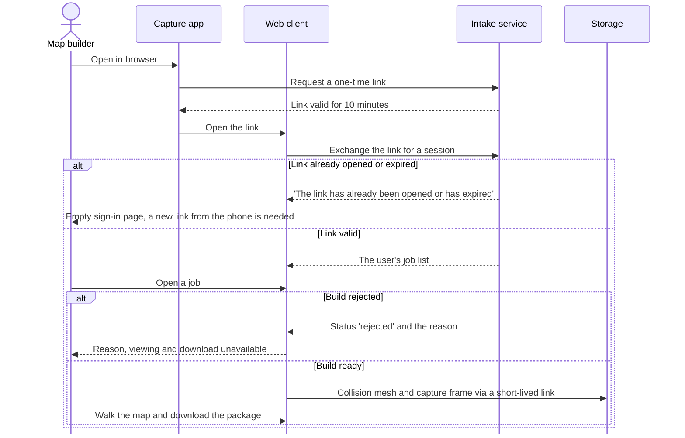

# Appendix 2. Diagrams

```mermaid
flowchart TB
  subgraph L1[Level author]
    direction LR
    S(( )) --> A1[Capture the place in a scanner]
    A1 --> A2[Export a dense model]
  end
  subgraph L2[3D artist]
    direction LR
    B1[Clean up and simplify the model] --> B2[Build a collision mesh]
    B2 --> B3[Set the scale]
  end
  subgraph L3[Game developer]
    direction LR
    C1[Import into the engine] --> C2{Does the character get across the level?}
    C2 -- Yes --> E((( )))
  end
  A2 --> B1
  B3 --> C1
  C2 -- No: capture defect --> A1
  C2 -- No: collision defect --> B2
  classDef manual fill:#fde2e1,stroke:#d9534f,color:#111;
  classDef node0 fill:#111,stroke:#111;
  class B1,B2,B3,C2 manual
  class S,E node0
```

Image A.2.1. AS-IS process: a level from a real place today

UML activity diagram with swimlanes by role. Manual steps and the late check are marked in red. All three roles may be played by one person.

```mermaid
flowchart TB
  subgraph L1[Capture operator]
    direction LR
    S(( )) --> A1[Walk around the zone for 10–30 seconds]
    A3[Send the capture]
  end
  subgraph L2[NVC Maps system]
    direction LR
    B1[Check the recording on the phone] --> B2{Is the recording usable?}
    B2 -- No --> B3[Show the reason and 'Retake']
    B4[Build the map on the server] --> B5{Conditions of Table 2.10 met?}
    B5 -- No --> B6[Rejection with a reason]
    B5 -- Yes --> B7[Package and report ready]
  end
  subgraph L3[Map builder and game developer]
    direction LR
    C1[Walk the map in the browser] --> C2{Does the character get across?}
    C2 -- Yes --> C3[Download the package into the engine]
    C3 --> E((( )))
  end
  A1 --> B1
  B2 -- Yes --> A3
  A3 --> B4
  B3 --> A1
  B6 --> A1
  B7 --> C1
  C2 -- No --> A1
  classDef node0 fill:#111,stroke:#111;
  class S,E node0
```

Image A.2.2. TO-BE process: a level with NVC Maps

UML activity diagram with swimlanes by role. There are no manual fixing steps; defects are caught by the recording check and the build rejection.

Image A.2.3. Context diagram

Image A.2.4. Use case diagram

Image A.2.5. System sequence diagram of UC-1 "Capture and send an area"

Image A.2.6. System sequence diagram of UC-2 "Check the map in the browser"

```mermaid
flowchart TD
  S(( )) --> A[Open 'Scan']
  A --> B[Zone frame 0.8 × 0.8 m]
  B --> C[Walk around for 10–30 seconds, stop]
  C --> D{"Check: 10–30 s, path ≥ 0.28 m, view change ≥ 90°, zone ≤ 0.92 m, pose gap ≤ 0.5 s"}
  D -- Failed --> E[Reason and 'Retake']
  E --> A
  D -- Passed --> F[Send]
  F --> G{Connection available?}
  G -- Lost --> H[Send again]
  H --> I{Capture already on the server?}
  I -- Yes --> J[Return the existing job]
  I -- No --> K[Create a job]
  G -- Yes --> K
  J --> Q[Job queued]
  K --> Q
  Q --> Z((( )))
  classDef node0 fill:#111,stroke:#111;
  class S,Z node0
```

Image A.2.7. Activity diagram of UC-1 with alternative flows
